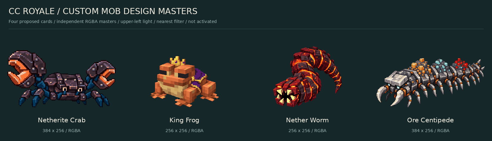
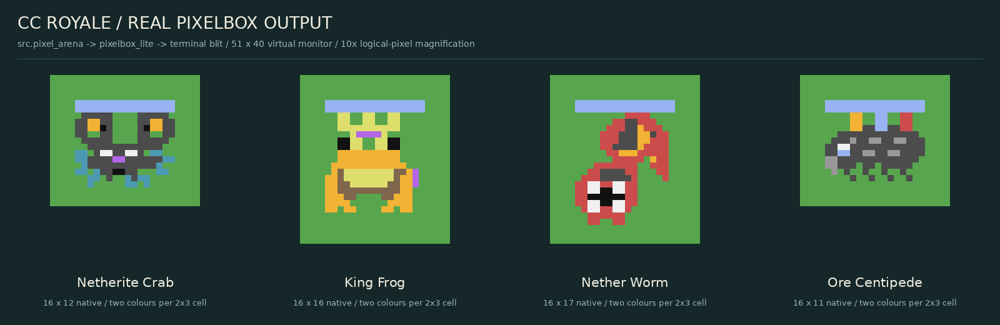

# Custom Mob Card Design Expansion — visual / concept review

**Four finished static design masters and compatible native art, proposed mechanics only.**
Based on current `main` **6e85dc77553bd17422deeb9cb51258cefda06fe5** (2026-10-16).
This package adds no playable card, production import, gameplay timer, balance change or renderer change.

**Owner revision:** only **King Frog** and **Nether Worm** are selected for subsequent implementation; Crab and Centipede remain deferred assets/concepts. Frog: **3E /550 HP**, Fisherman-style tongue hook followed by melee. Worm: **3E /350 HP**, arena-wide placement, normal95 damage to units/buildings and47.5 to either crown-tower type. The existing unit-only opener remains separately documented.

[Focused King Frog / Nether Worm sprite review](previews/selected_pair_review.png).
The current repository has **25 base cards**, not the historic 22. Existing PR #20 is separate and is not a dependency.





[Direct LÖVE → native → PixelBox comparison](previews/comparison.png) ·
[Native rows, enlarged and 1×](previews/cc_native_roster.png) ·
[Full real virtual-monitor capture, 6×](previews/virtual_monitor_6x.png) ·
[All 13 native poses](previews/native_poses.png)

## Assets and import metadata

| Mob | Independent LÖVE PNG | Canvas / foot pivot | Native key / dimensions | Reference |
|---|---|---|---|---|
| Netherite Crab | [netherite_crab.png](love2d/netherite_crab.png) | 384×256 / (192,240) | `netherite_crab` / 16×12 | [Official 2023 Mob Vote concept](https://www.minecraft.net/en-us/article/mob-vote-crab); our armor is custom |
| King Frog | [king_frog.png](love2d/king_frog.png) | 256×256 / (128,240) | `king_frog` / 16×16 | [Vanilla frog](https://www.minecraft.net/en-us/article/mob-menagerie--frog); crown/mantle are custom |
| Nether Worm | [nether_worm.png](love2d/nether_worm.png) | 256×256 / (128,240) | `nether_worm` / 16×17 | Original custom Nether creature |
| Ore Centipede | [ore_centipede.png](love2d/ore_centipede.png) | 384×256 / (192,240) | `ore_centipede` / 16×11 | Original custom ore-eating arthropod |

Native data: [cc_tweaked/sprites.lua](cc_tweaked/sprites.lua), a standalone data-only Lua module.
Its remaining nine entries are guard/tongue/bite/emergence/warning/feeding/reserve studies.
No entry is registered with `src.mob_assets`, `src.cards` or the live sprite roster.
`require("assets.proposed.custom_mobs.cc_tweaked.sprites")` returns only art data on a host configured with the repository Lua path; this package is not in the CC installer manifest.

All LÖVE PNGs are **RGBA with binary alpha**, 40 visible colors per sprite, zeroed transparent RGB, upper-left light, clear margins and a shared foot line. No label, ground plate, baked shadow or background is included. The masters were generated independently using the approved roster as reference, then exported with nearest sampling and no-dither palette control. CC rows were drawn separately from those designs; no master is an upscale of CC rows. Original generated PNGs are preserved in `source/`.

The native renderer places sprites by their **center** `(width/2,height/2)` and snaps to 2×3 cells. This is a different anchor convention from the future LÖVE foot pivot. No collision radius, world coordinate or HP-bar location has changed. Native colors use the repository's 16-token palette; `.` leaves terrain visible. The two-color sextant limit intentionally removes some tiny details.

For LÖVE, [love2d/index.lua](love2d/index.lua) supplies file/size/anchor metadata. Load each image with `love.graphics.newImage`, call `image:setFilter("nearest","nearest")`, and draw with `originX=anchorX`, `originY=anchorY`. Integer scaling preserves hard pixels. Facing directions, walking and combat animations still need additional LÖVE frames; the delivered masters each contain **one complete main pose**.

## Design, balance and feasibility

- [Four card designs and concrete stat proposals](balance/CARD_DESIGNS.md)
- [Machine-readable proposals](balance/proposals.json) and [read-only baseline card snapshot](balance/current_cards.json)
- [Engine inspection, integration boundaries, Worm state machine, counterplay and future test plan](documentation/TECHNICAL_DESIGN.md)
- [Animation / effect plan and actual delivered native studies](documentation/ANIMATION_PLAN.md)
- [Art provenance, visual audit and limitations](documentation/VISUAL_REVIEW.md)
- [Exact dimensions, colors, source links and SHA-256 hashes](MANIFEST.json)
- [Validation results and reproduction](evidence/VALIDATION.md)

## Reproduce / validate (host only)

Dependencies: Lua 5.2 + 5.4; Python 3.12 or newer; **Pillow 12.3.0**; DejaVu Sans.
From repository root:

```sh
python3 assets/proposed/custom_mobs/tools/export_love.py
lua5.2 assets/proposed/custom_mobs/tools/test_assets.lua /tmp/custom52.json /tmp/monitor52.json
lua5.4 assets/proposed/custom_mobs/tools/test_assets.lua /tmp/custom54.json /tmp/monitor54.json
lua5.2 assets/proposed/custom_mobs/tools/snapshot_cards.lua /tmp/current-cards.json
python3 assets/proposed/custom_mobs/tools/validate_assets.py --capture52 /tmp/custom52.json --capture54 /tmp/custom54.json --monitor52 /tmp/monitor52.json --monitor54 /tmp/monitor54.json --snapshot /tmp/current-cards.json
```

For an intentional visual revision, write the fresh captures to the committed `evidence/*lua52.json` / `*lua54.json` paths, run `tools/render_previews.py`, then `tools/build_manifest.py`, then validation. Rendering reads the actual `src.pixel_arena` and `lib.pixelbox_lite`, intercepts virtual monitor `blit`, and decodes its emitted sextant bytes. The harness injects private sprite slots only during host tests and restores them even on capture failure.

No physical CC:Tweaked monitor or running LÖVE installation was available. Virtual captures prove renderer compatibility, not physical monitor timing or visual approval. Gameplay values remain untested proposals. Merge and production activation await the owner's visual and conceptual review.
