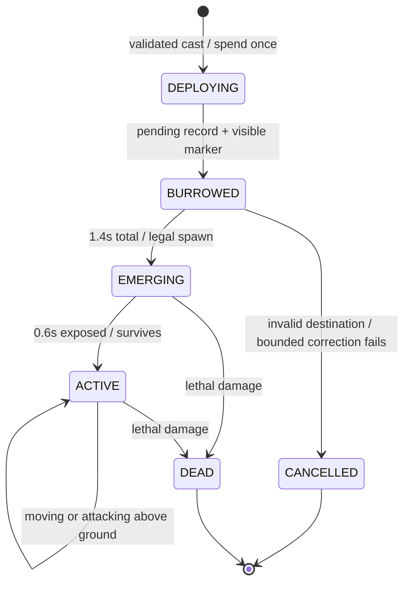

# Engine feasibility — inspected, not implemented

Baseline: `6e85dc77553bd17422deeb9cb51258cefda06fe5`, 2026-10-16. All proposed names below are **future interfaces**, not capabilities added by this package. The owner selected **only King Frog and Nether Worm** for the next implementation; Crab/Centipede remain deferred.

## Verified current architecture

| Concern | Current source | Consequence for these designs |
|---|---|---|
| Card data | `src/cards.lua`, `cards.list`, 25 base cards | Keep proposal JSON outside the registry and installer. No hand/deck/evolution changes here. |
| Placement | `src/arena.lua:243`, `arena.placementAllowed` | Finite coordinates; 3-unit border. `anywhere` returns **before river rejection**. Ordinary cards use own-half/pocket rules; simply using `anywhere` for a ground unit is unsafe. |
| Traversable terrain | `src/arena.lua:135`, `arena.isWalkable` | Ordinary ground crosses river only on bridges. Deployment and movement legality differ: ordinary deployment currently rejects the whole river strip, including bridges. |
| Spawn / lifecycle | `src/game.lua:306`, `spawnUnitFromStats`; `Game.playCardFromSlot` at 2815 | Unit branch spawns immediately. Delayed Anvil at `updatePendingSpells` (2694) is a useful timing precedent, not a delayed-unit mechanism. Successful play spends emeralds/cycles at cast time. |
| Targets | `src/game.lua:499`, `targetAllowed`; `acquireTarget` at 641 | Checks alive/owner/air/water reach/kind; no generic underground immunity or targetability state. Unit acquisition prefers nearby non-towers, then lane-aware tower objectives. Target locks persist until invalid. |
| Movement / displacement | `src/game.lua:838`, `moveToward`; `src/spatial.lua` | Point positions with walkability and axis fallback. Movement updates the spatial bucket. No general facing, multi-segment collision, swept body, mass or knockback service was found in these paths. |
| Damage / healing | `src/game.lua:992`, `damageEntity` | Common HP subtraction, damage accounting, flash, reflect and kill handling. No generic armor/heal/guard resource contract. Proposed mitigation must happen before actual-damage accounting and reflection; healing needs a separate capped operation. |
| Status modifiers | `src/combat_modifiers.lua` | Existing movement slow and Hero Web attack modifier; no generic buff/aura stacker. Avoid silently repurposing slow as Frog pull. |
| Towers / spells | `src/game.lua:419–431`; `src/cards.lua` | Princess 80 / 0.95s, King 105 / 0.9s. Arrow Volley185; Anvil549 after2.7s. Existing tower locks and spell victim queries must remain valid during emergence. |
| Bot | `src/bot.lua:964`, `clampOwnPlacement`; 987/1101 defensive/offensive placement | Current troop candidates are clamped to own half. New arena-wide card needs its own candidate strategy and shared validator, rather than globally relaxing placement. |
| Headless | `src/headless_match.lua`, `Runner.run`; `Game.update` at 3538 | Same simulation update with seeded RNG and controlled bot order. New logic must use simulation `dt`, not `os.clock`, image state, GIF time or render rate. |
| Graphics | `src/pixel_arena.lua`, `drawSprite`, `canvasChanged`, `spriteFor`; `src/mob_assets.lua` | Native art max16×18 tested. Center placement snaps to 2×3. HP/team overlays and final-canvas frame diff already exist; additional frames need future explicit dispatch. |
| PixelBox | `lib/pixelbox_lite.lua` | Each terminal cell represents 2×3 logical pixels using only two CC colors. Arbitrary per-pixel RGB and three colors per cell cannot survive exactly. |

The atlas uses the existing footprint limits without global scaling. Long bodies are folded (Worm) or summarized horizontally (Centipede). Every creature remains one gameplay entity with one position. Legs, tail and ore segments are visual geometry, not extra entities, damage zones or hitboxes.

## Nether Worm: mandatory arena-wide placement contract

Proposed private mode: `all_arena_walkable_ground`. Only this card selects it; normal card placement remains byte-for-byte as today. Client preview, play validation and bot scoring must call the same pure validator later.

Validation order:

1. Reject non-numbers, NaN/infinities, invalid owner and coordinates outside `[3,97] × [3,157]` in the current100×160 arena.
2. Accept ground walkability on **either half**, independent of Princess destruction or pocket unlocks. River outside bridges is invalid; bridges are valid walkable ground for this card. This is a documented card-specific exception to ordinary bridge deployment.
3. Reject positions within a proposed **6-unit center exclusion radius** of any live tower/building, including friendly ones. This is a new deployment clearance rule, **not an existing physical hitbox**. Ground troops do not hard-block because the current engine does not separate colliding troops; no displacement on emergence.
4. Behind-tower placement is expressly legal: player1 can target `(42,4)`, behind enemy King `(50,9)`; mirror for player2 is `(58,156)`, behind enemy King `(50,151)`. Both remain within bounds and outside the proposed clearance radius. `(25,20)` is behind enemy Princess `(25,28)` and also valid. No own-half fallback.
5. At acceptance, spend/cycle exactly once using the normal play transaction and append a pending record. Invalid casts spend nothing. Moving the cursor afterward does not move the warning.
6. At emergence, revalidate the committed point against new buildings/terrain. If blocked, search offsets within radius4 in an owner-relative deterministic ring order (radius0,2,4; eight compass offsets per nonzero ring). Transform offsets for owner2 so equivalent scenes mirror exactly. Validate all candidates, never cross illegal terrain or silently clamp to own half. Bound this search to17 checks. Choose the first legal point; show any correction with the final warning marker before spawning. For clear warning honesty, reserve the final0.3s of the1.4s warning for this revalidation/correction, then recheck without further movement at spawn.
7. If no legal corrected position exists, or the chosen position becomes blocked in that final0.3s, cancel: refund the committed3 emeralds capped at emeraldMax; do not rewind the hand/cycle or double-count a card play. Record a cancelled deployment and refund separately from gross emerald spending. Never create a troop inside a building or refund after it has become targetable. This edge-case economy policy requires review and explicit tests.

The local correction is limited, visible, and cannot turn an enemy-backfield cast into an own-side cast. New static-building overlap needs this rule because the present placement API does not provide occupancy checks.

## Proposed Worm lifecycle

| Phase | Authoritative representation | Targetable / AoE / tower aggro | May move / attack |
|---|---|---|---|
| DEPLOYING | accepted transaction, zero-duration transition | No entity yet | No |
| BURROWED | proposed `state.pendingDeployments` record, fixed marker,1.4s timer | No unit to target or damage; no collision; cannot deal damage | No |
| EMERGING | normal grounded alive unit, in `entities` and spatial index, full350HP | **Yes from the first emerging tick**, all ordinary permitted sources and AoE | Neither for0.6s |
| ACTIVE | normal unit, action state MOVING or ATTACKING | Yes; normal lock/aggro rules | Ordinary movement and bites |
| DEAD | ordinary kill/cleanup path | No, once only | No |
| CANCELLED | pending record removed, refund policy once | No | No |

The pending record avoids making an underground alive entity invisible only to one targeting function while towers, AoE or the spatial index still see it. It contains a unique deployment ID, owner, source card ID, committed target, reserved cost, remaining warning and any final correction. It grants no on-hit bonuses, damage, rewards or collision before spawn.

On spawn, initialize an emergence lock and attack delay of at least0.6s; current ready-on-spawn attacks must not bypass it. **No first bite before2.0 seconds after acceptance.** After ACTIVE starts, the one-use troop-only bonus expires after2 seconds. MOVING/ATTACKING are normal activity states; no return edge to BURROWED exists. When time runs out, phase changes to result, arena resets or a match is abandoned, clear pending records without spawning into the next state. Cancellation on match end has no spend/refund effect on a completed match result. Future serialization/replay/state-hash code must include pending timers; no save format changes are made now.

Process time boundaries deterministically with remaining-`dt` carry; incoming damage/death wins over an attack whose unlock boundary occurs at the same time. Test dt0.05/0.10/0.25 and boundary tolerances. Never drive this FSM from `visualAnimation` or particle lifetime. Warning/emergence VFX are projections of authoritative state; headless omits artwork but uses identical decisions.

## Other minimal integration proposals

**Crab:** a per-unit stance timer and cooldown; explicit attack/movement gate during guard; an optional incoming hostile-damage multiplier in the common damage path. Apply reduction before reporting actual damage, reflect and death. No front-angle rules, permanent armor, generic shield framework or altered hitbox. Future proof with simultaneous sources, reflect, overkill, cancellation and timed cooldown tests. Never lower lifetime/tiebreaker damage by accident.

**Frog:** separate hook acquisition from the regular melee attack. Proposed sequence: READY → HOOK_WINDUP(0.25s) → PULL → MELEE; cooldown4.2s after a hook attempt, normal40-damage /1.4s attack cadence preserved. Hook range12, melee/destination distance2.5, maximum displacement9.5. Hook damage0; no ranged basic attacks or extra immediate hit. Revalidate the opponent's live/ground-unit status and range at completion; all ground unit sizes qualify. Resolve immutable buildings/towers/flying/water targets as hook-ineligible and allow ordinary melee attacks where permitted.

Sweep the requested straight segment at ≤0.5-unit increments through `arena.isWalkable`; stop at the last legal point and never slide along another axis or cross non-walkable river. Target position updates require `spatial.index`; preserve attack progress and normal validity-based lock rules. Use stable entity-ID resolution and a per-victim same-tick pull guard so a second Frog cannot relocate that victim again in the same tick. A successful full hook brings the victim to2.5 units; the old4-unit displacement cap and small-unit whitelist are removed. No persistent stun or lifetime renewal. A blocked/partial hook cannot create range12 damage: the Frog must reach melee range before attacking. Test hooked passive Villager/Bank entities without altering `emeraldBoost` registration or remaining lifetime.

**Worm damage and target classification:** future tower reduction must be guarded by `target.kind == "tower"`, covering both Princess and King. Multiply normal95 by0.5 for47.5; leave buildings/units at95. Keep the previous unit-only+85 opener separately, with180 on the first eligible troop hit and no bonus on actual buildings/towers. `src/cards.lua:367` defines Villager as `kind="unit"` and its Emerald Bank evolution changes its visual variant/HP/lifetime, not entity kind. Both are full-damage economic targets. On target acquisition only, prefer a legal nearby economy/support unit; do not override a valid locked target every tick. Full building damage must include Cannon/Outpost/Portal and must not accidentally classify Bank by its sprite or name. Add a target-kind matrix to future executable mechanics tests.

**Centipede:** integer `oreCharges`0..3, channel timer and retry cooldown. Start only with sufficient missingHP; completion revalidates alive/HP cap, consumes one charge after an actual heal, and records separate effective healing. Incoming positive actual hostile damage cancels before heal resolution. No resource entities, ore mining, per-ore abilities or new arena rules. The visual cache count must be derived from the integer reserve, including late viewers; cosmetic particles may not consume it.

## Bots, simulations and implementation risk

| Proposed feature | Risk | Future targeted acceptance |
|---|---|---|
| Arena-wide Worm | High: placement, pending transaction, tower locks, late match cleanup and asymmetric bot candidates | Both owners; behind each tower; invalid river/building/border; moved victim; final-marker correction; cancellation/refund once; no second burrow; unit/building95 versus both towers47.5; economy targets; troop-only opener |
| Frog pull | Medium/high: terrain sweep, spatial buckets, simultaneous units and existing locks | Bridge corners; air/building immunity; all ground-unit sizes; hook→melee; passive Bank; two frogs; no attack reset; mirrored owner tests |
| Crab guard | Medium: damage accounting, reflect and overlapping timing | windup unprotected;35% exactly; spells included; death/overkill; cooldown not reset; headless parity |
| Centipede feed | Medium: finite resources, interrupt order and visual state | Three heals max;0-charge gate; HP cap; cancel no charge loss;6s retry; damage/death before completion; no income |
| Native animations | Low/medium: visual dispatch and final-canvas cache | Repeated frame = no extra blits; changed pose visible; crop clean; both teams/viewers; no state mutation |

Existing bots score known IDs and conventional troop pressure. Future Worm candidates must cover both halves using shared validation and estimate target position after2s; avoid dropping into overwhelming tower fire or onto departing support. Frog evaluation needs hook destination safety and a distinct melee-range check; Crab guard downtime and Centipede realized healing matter. Do not claim a headless balance result until these behaviors exist and bots exercise them.

**Current PR boundary:** only concepts, PNGs, Lua art data, host tools, isolated asset validation and its CI. No suggested hook above is implemented in `src/`, `lib/`, `config.lua`, cards, targeting, spells, economy, saves, bot or simulations. A later gameplay PR requires visual/concept approval plus executable mechanics tests before activation.
