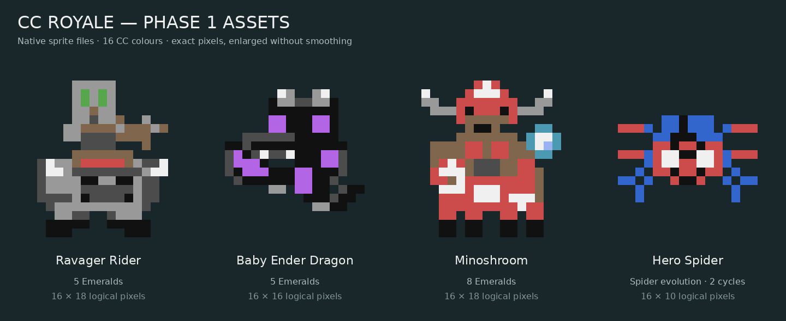
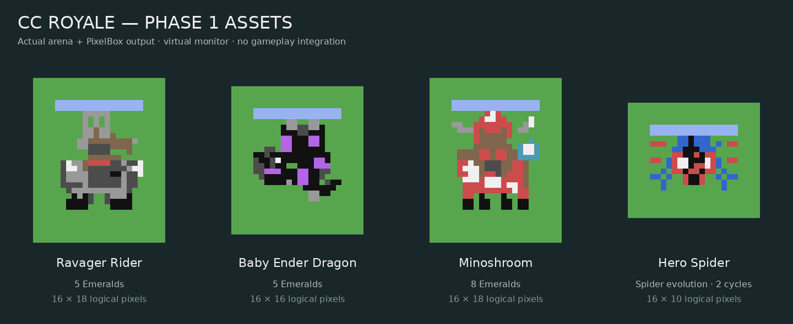

# Four mobs — Phase 1 only

Source-of-truth revision: `4490cbdd00c2a7995155eb6bcb5828b3ac65d04e`.
Style: the user-approved colourful, blocky Minecraft sprite roster.

**PHASE 1: native assets and isolated QA. PHASE 2: NOT STARTED.**
No card is registered; no gameplay file, existing sprite or installer manifest
is changed. This directory is never loaded by normal startup/main/admin/bots.
The sole existing-file change is the VIS-003 feature entry in the audit register.
A new host-only workflow checks the isolated asset branch. No merge is allowed.

## Actual graphics

These are actual row-file pixels, not AI concept paintings:




The second sheet uses the unmodified game's sprite rasterizer and PixelBox
encoder on a virtual monitor, including the existing team HP bar. Pixels were
enlarged with nearest-neighbour sampling. Default ComputerCraft RGB colours
are assumed; physical monitors/custom palettes remain NOT TESTED.

| Set | Native size | Unit frames | Effect/projectile frames |
| --- | --- | --- | --- |
| Ravager Rider | 16×18 | 8 | 4 |
| Baby Ender Dragon | 16×16 | 5 | 4 |
| Minoshroom | 16×18 | 6 | 2 |
| Hero Spider | 16×10 | 6 | 5 |

See the complete [Rider](previews/ravager_rider_set.png),
[Dragon](previews/baby_ender_dragon_set.png),
[Minoshroom](previews/minoshroom_set.png) and
[Spider comparison](previews/hero_spider_set.png) sheets.
Rider has separate shot/hit poses plus a combined pose; Minoshroom preserves
Twilight Forest's taur anatomy with four cow legs and the diamond minotaur axe.
Hero Spider retains four articulated leg endpoints on each side, with a red
web-patterned mask, blue abdomen and white comic eyes.

## Format and technical limits

Eight Lua files contain only returned data tables: `sprites/<id>.lua` and
`effects/<id>.lua`. Every frame has `width`, `height` and equal-length `rows`.
Palette tokens exactly match `src/pixel_arena.lua`:
`K W S D G L B A C R Y N P M O I`; `.` reveals terrain and optional `T` is team
colour. No new palette, image loader, texture API or runtime dependency exists.
Static row frames fit the current native sprite contract (maximum 16×18).

Four transparent PNG atlases provide all 40 frames as a second representation;
`previews/atlas_layout.json` lists their exact pixel rectangles. Atlases are
export/inspection artifacts; the game currently reads Lua rows, not PNGs.
The two-colour limit within each 2×3 PixelBox cell can discard small details.
Isolated tests confirm the characteristic eye colours survive actual encoding.
All 40 new frames also have identical displayed pixels under native Lua 5.2
and 5.4. Unused foreground bytes can differ without changing the image. The
legacy normal-Spider comparison has a two-pixel host-encoder tie variation;
the original sprite/encoder is intentionally unchanged. Sheets use Lua 5.2
captures; real Cobalt/custom-palette output still requires field observation.

**Animation sequences are concept/preparation assets, not live animations.**
The current engine has no general movement/attack frame dispatcher. All 25
unit poses render correctly as individual static frames. Eleven GIF sequences
play those real captures offline; their visual durations are not attack
cooldowns. Runtime frame selection is reserved for Phase 2.

**New projectile/effect rasters are also not live-dispatched.** Their previews
draw the actual token rows onto the real PixelBox canvas in a test fixture.
They require Phase-2 visual dispatch hooks. The existing procedural
`crossbow_bolt` could alternatively be reused unchanged for Rider combat.
The impact and permanent-web graphics do not apply damage or status effects.
The normal Spider comparison comes directly from the existing renderer.

## Reproduce host-only checks

Run from the repository root with Lua 5.2 or 5.4 and Python/Pillow:

```sh
lua5.2 assets/proposed/four_mobs_phase1/tools/test_assets.lua
lua5.4 assets/proposed/four_mobs_phase1/tools/test_assets.lua
lua5.4 assets/proposed/four_mobs_phase1/tools/capture.lua
python3 assets/proposed/four_mobs_phase1/tools/preview.py
python3 assets/proposed/four_mobs_phase1/tools/validate_previews.py
```

The host harness uses `debug.getupvalue` to temporarily supply a frame to the
existing private sprite dictionary, restoring it after every capture/error.
It is not an in-game script and is not installed. CraftOS intentionally does
not expose those native debug facilities. Asset data itself needs none of them.
`tools/build_assets.py` is the deterministic pixel authoring source;
`tools/balance.py` regenerates **proposals only** from captured current stats.

Results and explicit PASS/NOT TESTED states: [VALIDATION.md](VALIDATION.md).
Proposed stats and economics: [BALANCE.md](BALANCE.md).
Later implementation and regression requirements: [PHASE2_PLAN.md](PHASE2_PLAN.md).

## References and authorship

All new pixel art is an original interpretation in the existing CC-Royale
style. The user's after.jpg and existing native roster provide the visual
direction. Twilight Forest reference source was inspected for anatomy and
equipment, not copied as a texture:
[MinoshroomModel](https://github.com/TeamTwilight/twilightforest/blob/1.21.x/src/main/java/twilightforest/client/model/entity/MinoshroomModel.java)
and [Minoshroom entity](https://github.com/TeamTwilight/twilightforest/blob/1.21.x/src/main/java/twilightforest/entity/boss/Minoshroom.java).
The model declares a cow torso, four cow legs, humanoid torso/arms, snout and
horns; the entity equips `DIAMOND_MINOTAUR_AXE`. The texture was consulted for
the red/white mooshroom treatment. No external mod/model runtime is required.
