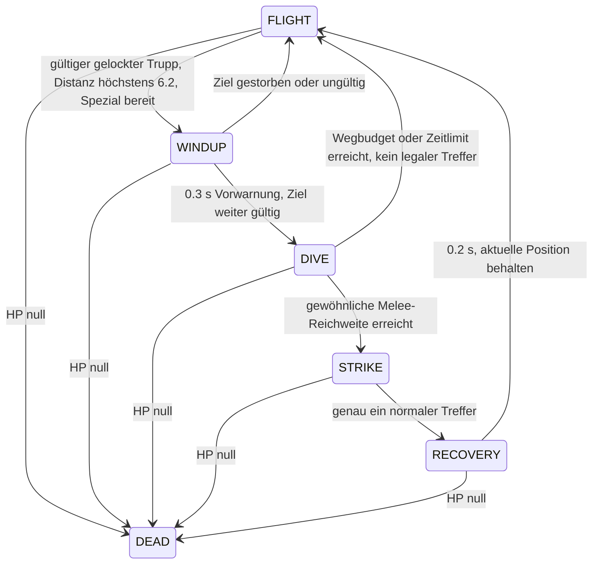

# Mechanikentwürfe – keine Implementierung

Alle Zahlen sind Startvorschläge. Verbindlich für dieses Paket sind nur die isolierten Grafikdaten. `BALANCE_PROPOSALS.json` ist Dokumentation, kein Registry-Input.

## Breeze – Wind Controller

**Vorschlag:** 3E, 320 HP, 32 Einzelzielschaden alle 1,4 s, Reichweite 15, Bewegung 6,6. Die Figur schwebt grafisch, bleibt spielmechanisch eine **Bodeneinheit**: normale Platzierung, Brücken und Bodennavigation. Sie greift keine Flieger und keine Wasser-Units an. Gebäude und Türme können normalen Schaden erhalten, werden aber niemals verschoben.

Die ersten beiden Schüsse sind normale kleine Windtreffer. Jeder dritte abgefeuerte Schuss ist ein lesbar aufgeladener Windstoß. Das ergibt bei normalem Angriffstempo 4,2 s zwischen verstärkten Schüssen; der erste kommt frühestens 2,8 s nach dem ersten normalen Schuss. Der Zähler zählt bestätigte Schussfreigaben, nicht Animationen oder mehrfach aufgelöste Treffer. Ein verlorenes Projektil spart keine Ladung für einen Gratis-Doppelschuss.

Der Windstoß verschiebt **nur das primäre getroffene gegnerische Bodentruppenziel** um höchstens vier Welteinheiten vom Breeze weg. Kein Schadensbonus, kein Flächenschaden, kein Stun, kein Angriffstimer-Reset und kein Umsetzen des Target-Locks. Der breite Effekt ist visuelle Winddarstellung, keine größere Kollisionsfläche.

### Sichere Verschiebung

1. Beim Einschlag erneut prüfen: Ziel lebt, gegnerische Unit, weder fliegend noch `waterOnly`.
2. Getroffene Unit hat eine gemeinsame dreisekündige Wind-Immunität gegen alle Breezes. Immunität wird nach einer erfolgreichen Verschiebung gesetzt; reiner Schaden bleibt möglich. Zwei Breezes dürfen nicht abwechselnd denselben Trupp im Dauerzustand halten.
3. Den gesamten Weg in höchstens 0,25-Welteinheiten-Schritten prüfen. `arena.isWalkable` und die normalen Arena-Grenzen gelten in jedem Schritt. Am ersten ungültigen Punkt stoppen, niemals auf die nächste gegenüberliegende Uferposition springen.
4. Maximal vier Einheiten; an einer Wand/Brückenkante darf das Ergebnis kleiner oder null sein. Keine seitliche Ersatz-Teleportation und kein anschließender Gratis-Nav-Snap.
5. Die bestehende Unit-ID erhalten, den Spatial-Index nach echter Positionsänderung aktualisieren. Reihenfolge bei gleichzeitigen Treffern deterministisch festlegen. Keine Entity-Kopie und keine neue Spawnposition.

Die bestehende Frog-Pull-Regel tastet bereits einen Weg in 0,5-Schritten ab. Das ist eine hilfreiche vorhandene Sicherheitsidee, aber keine universell fertige Knockback-Funktion. Eine spätere gemeinsame Displacement-Abstraktion darf nicht ungeprüft Pull-Reichweite, Bridges oder Frog-Targeting verändern.

### Gegenwehr und Meta

Snow Golem bietet bereits Slow und Anti-Air für 3E, King Frog gezieltes Heranziehen und Hero Spider eine starke Bodenkontrolle. Breeze bekommt deshalb **kurze positionsbezogene Abwehr** statt weiteren Slow, permanenten Debuff oder Pull. Gegen Gruppen bleibt er absichtlich schwach: Ein Schuss beziehungsweise Windstoß kontrolliert nur ein Ziel.

Luftangriffe umgehen seinen Bodenangriff. Fernkampf, mehrere günstige Ziele und die lange Ladungsfolge bestrafen ihn. Brückenkanten begrenzen oft seinen Rückstoß. Gegen schnelle Nahkämpfer entsprechen vier Welteinheiten nur etwa einer halben Sekunde erneutem Heranlaufen; das ist kein mehrsekündiger Stun.

Ein Verbündeter kann den zurückgedrängten Gegner weiter beschießen. Eine eigene Frog-Zunge kann taktisch widersprüchlich wirken, wenn Breeze das mühsam herangezogene Ziel wieder wegschiebt. Eigene Units werden nie verschoben. Spells, Mass Knockback und Tower-Umsortierung sind nicht Teil dieses Entwurfs.

**Bot-Risiko:** Ein Bot muss später ungefährlichen Tower-Poke von defensiver Wind-Kontrolle unterscheiden. Die bestehende DPS-/Reichweitenbewertung allein unterschätzt Positionsnutzen. Einfache Bodentruppen-Heuristik vor weiteren Cone-/Gruppeneffekten bevorzugen.

## Adventure Sheep – Reliable Medium Melee

**Vorschlag:** 4E, 620 HP, 82 Nahkampfschaden alle 1,1 s, Bewegung 7,4, Reichweite 2,5, normale Bodenplatzierung und Zielwahl. Nur ein Ziel, keine Flieger, kein Fernkampf und keine Selbstheilung.

Das intelligente Schaf bleibt ein vierbeiniger Erkunder: Diamanthelm, Eisenschwert im Maul, viel weiße Wolle. Kein humanoider Oberkörper, keine Arme, kein zusätzlicher Schild oder Zauber. Die kurze Geschichte ist im visuellen Design enthalten; sie begründet keine versteckte Intelligenz-/AI-Spezialregel.

### Entscheidung zur Fähigkeit

**Keine passive Fähigkeit empfohlen.** Normale robuste Basiswerte treffen die gewünschte Duellrolle bereits im begrenzten Rechenmodell. Ein gelegentlicher Helmblock ist eine untersuchte Alternative, kein zusätzliches Feature: allenfalls einen ersten direkten Nahkampftreffer geringfügig reduzieren, deutlich einmalig anzeigen und nicht gegen Spells/Projektile. Derzeit überwiegen zusätzlicher Zustand, Erklärbedarf und Balanceunsicherheit.

### Schwertschlag

Während der letzten etwa 0,3 s vor dem Treffer zieht das Schaf den Kopf zurück. Es schwingt das im Maul gehaltene Schwert seitlich/abwärts, zeigt einen kurzen silbernen Bogen und kehrt zur stabilen Ausrüstungspose zurück. Die Schadenserteilung darf später **einmal** am normalen bestätigten Melee-Treffer hängen. Weder Kopfbewegung noch Effektframe lösen eigenen Schaden aus.

Der Silberbogen ist kein Splash-Angriff. Eine geänderte Zielposition, Sprite-Größe oder große Bogenzeichnung vergrößert keine Attack Range. Die Animation darf nicht dazu führen, dass tote oder wegbewegte Gegner nachträglich einen garantierten Treffer erhalten.

### Taktische Nische

Das Schaf hat mehr HP als die 3E-Duellanten, bezahlt dafür 4E und geringere DPS. Zombie ist billiger; Wither Skeleton bietet mehr Schaden pro Treffer und Sekunde. Wolf ist schneller und offensiver, Spider günstiger und schneller. Iron/Diamond Golem behalten ihre sehr viel höhere HP und Gebäudeorientierung. Enderman hat für 5E dieselben 620 HP, aber 95 statt 82 Schaden und Teleport.

Ein konkreter Haltbarkeits-Breakpoint ist Falling Anvil: Die aktuellen 549 Truppenschaden töten volle normale Zombies/Wither Skeletons, lassen Sheep aber 71 HP. Zwei normale Minoshroom-Treffer zu je 300 lassen rechnerisch 20 HP übrig. Das macht Sheep nicht zu einem Minoshroom-Counter; es erklärt den gewünschten robusten Einzelkörper. HP/E und DPS/E sind bei 4E trotzdem konservativ – ein realer Playtest muss den Mehrpreis rechtfertigen.

Ranged-Kiting, Swarms und Air bleiben klare Probleme. Ein Schaf hinter einem Golem hält einen kleineren gegnerischen Nahkämpfer auf; es ersetzt keinen Anti-Air-Slot und keinen Tank. Gegen Türme erhält es keinen Bonus. Einzelne unterstützte 3E-Truppen können es trotz der rechnerischen Duellstärke kosteneffizient stoppen.

**Bot-Risiko niedrig:** normale Medium-Melee-Klassifikation mit höherem Preis; keine Zielprioritäts- oder Spezialfähigkeits-Heuristik notwendig. Den Schwertbogen darf die Bot-Vorhersage niemals als Flächenschaden interpretieren.

Die Zahlen und tatsächlichen Modellannahmen stehen in [BALANCE.md](BALANCE.md). Es wurden keine neuen Karten in einer produktiven Engine-Simulation erzeugt.

## Phantom – Flying Backline Hunter

**Vorschlag:** 4E, 280 HP, 76 Einzelzielschaden alle 1,3 s, normale Flugbewegung 10, Nahkampfreichweite 2,2, normale Aggro-Reichweite 28. Kann Luft und Boden treffen. Gebäude und alle Türme erhalten nur 50 % des normalen Schadens: 38 je Treffer. Kein Zusatzschaden beim Sturzflug.

Bats sind bereits billige fliegende Schwarm-DPS, Blaze ist fliegender Fernkampf und Baby Ender Dragon fliegender Splash-Support. Phantom wird daher ein **einzelner kurzer Nahkampf-Hunter** mit begrenzter lokaler Erstzielpräferenz. Enderman und Nether Worm decken bereits Teleport-/freie Ambush-Platzierung ab; Phantom bekommt beides ausdrücklich nicht.

### Zielwahl ohne Lock-Bruch

Eine intakte Zielbindung bleibt intakt – auch beim Wechsel zwischen Flug-, Windup- und Recovery-Animation. Die vorhandene Engine löst einen Unit-Lock erst bei Tod oder ungültigem Ziel. Eine Phantom-Eigenschaft darf das nicht pro Tick oder beim Auftauchen eines neuen Ranged-Gegners umgehen.

Nur bei einer **regulären neuen Zielsuche** darf eine gegnerische verwundbare Fernkampf-Unit innerhalb von 14 Welteinheiten bevorzugt werden. Alle normalen Zulässigkeitsregeln gelten. Ohne solches Ziel wird die normale Erwerbungsregel verwendet. Keine Suche durch die gesamte gegnerische Arena.

Für eine spätere Implementierung wird eine kleine explizite Primärwaffen-Klassifikation empfohlen. Skeleton, Witch und Snow Golem sind klare Fälle; Blaze und Baby Ender Dragon sind angreifbare fliegende Fernkämpfer, aber selbst gefährlich. Passiver Villager, Gebäude und Tower sind keine Fernkampf-Units. Guardian ist `waterOnly` und aus der Präferenz ausgeschlossen. Ravager Riders zweiter Schütze macht den ganzen Gebäudetank nicht automatisch zum bevorzugten schwachen Supportziel. Evoker ist ein Caster-Grenzfall: vorerst keine automatische Sonderpriorität ohne Entscheidung.

### Begrenzter Sturzflug

- Windup 0,3 s sichtbar. Kein Abheben in Unverwundbarkeit und kein Angriffsrecht durch Animation allein.
- Sturzflug höchstens vier Welteinheiten bei maximal 16 Geschwindigkeit und 0,3 s Zeitlimit; bereits nach Ausschöpfen des Wegbudgets stoppen. Verlangsamungsfaktoren wirken weiter.
- Kein Teleport. Jeden Bewegungsschritt an den normalen Air-Grenzen prüfen; kein Abschneiden außerhalb der Arena und kein Positionssprung hinter einen Tower.
- Das Überqueren des Flusses ist nur die bereits erlaubte normale Flugbewegung. Kein Anywhere-Placement und kein Überspringen einer vorgeschriebenen Warte-/Spawnphase.
- Am Trefferpunkt gewöhnliche Range, Zielgültigkeit und normalen Attack Cooldown prüfen. Kein gratis zweiter Treffer durch STRIKE plus normalen Combat-Zweig.
- Fünf Sekunden Mindestabstand zwischen Sturzflug-Starts, auch bei Abbruch nach Beginn. Ein toter/ausweichender Gegner darf keine endlose WINDUP-DIVE-Retarget-Schleife erzeugen.
- Recovery findet an der erreichten Position statt; kein kostenloser Rückflug zur Startposition. Phantom bleibt in jedem Zustand für Anti-Air angreifbar und weiterhin fliegend.

### Gegenwehr und Meta

Tower-Aggro bleibt normal; kein Prioritätsdurchflug ohne Beschuss und kein Zurücksetzen von Tower-Locks durch Phasenwechsel. Fernkämpfer können während Windup, Annäherung und Recovery schießen. Blaze, Anti-Air-Kombinationen, fokussierte Tower und Slow bestrafen den fragilen Nahkampf-Flieger. Arrow Volley verursacht aktuell 185 Schaden: Sie tötet 280 HP nicht allein, lässt aber nur 95 übrig. Bat Swarm ist ein günstiger zusätzlicher Anti-Air-Druck, kein nachgewiesener Solo-Hardcounter.

Weil ein gültiges Nahziel den Lock hält, kann der Verteidiger Phantom regulär binden. Die Präferenz ist kein automatischer Schutzlinien-Bypass. Ein Phantom, das früh einen Tank bindet, bleibt an diesem Kampf beteiligt. 50 % Gebäudeschaden verhindern, dass die Hunter-Eigenschaft nur ein zusätzlicher Tower-Rusher wird.

**Bot-/Systemrisiko höher:** lokale Priorität muss Lock, Spatial Queries und deterministische Tie-Breaks respektieren. Die Bot-Vorhersage benötigt später den halben Gebäudeschaden und darf Dive nicht als Bonusburst rechnen. Spezialbewegung muss die normalen Slows verwenden. Die Vorschau implementiert keine dieser Regeln.

## Gemeinsam: Overtime, Reset und spätere Freigabe

Overtime erhöht derzeit den Emerald-Nachschub, nicht Bewegung oder Angriffstempo. Die vorgeschlagenen CDs und Immunitäten dürfen deshalb nicht automatisch beschleunigt werden. Mehr gleichzeitig ausgespielte Breezes machen die gemeinsame Opfer-Immunität besonders wichtig; Phantom-Suche muss lokale Spatial-Abfragen nutzen, statt pro Frame alle Entities mehrfach zu scannen.

Alle neuen zustandsbezogenen Daten müssten später unit-lokal initialisiert und bei Tod/Match-Neustart entfernt werden. Vorschau-Hit-/Death-Clips sind derzeit nur Bilder. Eine spätere Todesdarstellung sollte über ein zeitlich begrenztes visuelles Effektobjekt laufen; die tote Unit bleibt nicht zum Abspielen ihrer Animation kampffähig oder im Targeting.

Empfohlene spätere Reihenfolge nach expliziter Freigabe: **Adventure Sheep zuerst**, weil normale Nahkampflogik genügt; **Breeze danach** mit isolierten Terrain-/Mehrfach-Breeze-Tests; **Phantom zuletzt** mit Lock-/Bewegungs- und Anti-Air-Tests. Dieses Paket endet vor allen drei Implementierungsschritten.
