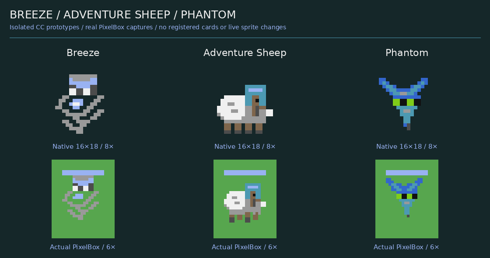

# Breeze · Adventure Sheep · Phantom

**CC-first Designprototypen – nicht registriert, nicht spielbar.**  
Basis: `main` / `e80ad6919b7eb21a1d3464290d177ee3ab210eee`, 17.10.2026.

**Nachträglicher Nutzerauftrag:** Die freigegebenen Designs liegen jetzt zusätzlich als [drei transparente LÖVE-Einzel-Sprites](love2d/README.md) mit Ankerpunkten und [echter Exportvorschau](love2d/previews/roster.png) vor. Das Adventure Sheep hält dort sein Eisenschwert seitwärts quer im Maul. Die CC-Prototypen bleiben unverändert; der folgende ursprüngliche Bericht beschreibt die CC-Phase.



Drei eigenständige Kartenideen mit 37 nativen Unit-Posen, sieben Effekt-Rastern, drei 12×12-Icons und zwei vergleichbaren Schafansichten. Die Einheitensprites bleiben bei 16×18 und den vorhandenen 16 CC-Farben. Alle Bilder stammen aus echten Zeilen/Captures; keine hochauflösenden Konzeptbilder werden als CC-Ausgabe ausgegeben.

## Animationen ansehen

| Entwurf | Hauptaktion | Weitere Clips | Sheet |
|---|---|---|---|
| Breeze | [Windstoß](previews/breeze_showcase.gif) | [Idle](previews/breeze_idle.gif), [Bewegung](previews/breeze_movement.gif), [Hit](previews/breeze_hit.gif), [Tod](previews/breeze_death.gif) | [Alle Posen](previews/breeze_sheet.png) |
| Adventure Sheep | [Maulschwert](previews/adventure_sheep_showcase.gif) | [Idle](previews/adventure_sheep_idle.gif), [Lauf](previews/adventure_sheep_movement.gif), [Hit](previews/adventure_sheep_hit.gif), [Tod](previews/adventure_sheep_death.gif) | [Alle Posen](previews/adventure_sheep_sheet.png) |
| Phantom | [Dive](previews/phantom_showcase.gif) | [Flug](previews/phantom_movement.gif), [Idle](previews/phantom_idle.gif), [Hit](previews/phantom_hit.gif), [Tod](previews/phantom_death.gif) | [Alle Posen](previews/phantom_sheet.png) |

[Interaktiver Offline-Viewer](previews/review.html) bietet pro Karte sechs Aktionen, Pause, Neustart, Frame-Regler und Tempo. HTML-Datei lokal öffnen; keine Netzwerkdienste erforderlich. Der Viewer nutzt die eingebetteten realen PixelBox-Captures und ganzzahlige 6×-Skalierung. Die 20 GIFs einschließlich zweier Arenaloops lassen sich direkt in GitHub ansehen.

[Schafvarianten](previews/sheep_variants.png) · [Icons](previews/deck_icons.png) · [Effekte](previews/effects.png) · [Arena P1](previews/arena_p1.gif) · [Arena P2](previews/arena_p2.gif).

Die Arena zeigt sechs Prototyp-Overlays und sechs bestehende Einheiten in einer gestellten Szene. Kein Kampf, keine Zielpriorität, kein Knockback und kein Dive-Movement wird simuliert. Die aktuelle Live-Deckansicht bleibt textbasiert.

## Vorschläge

| Karte | Rolle | E | HP | Schaden / Intervall |
|---|---|---:|---:|---|
| Breeze | Boden-Windkontrolle auf einem Primärziel | 3 | 320 | 32 / 1,4 s |
| Adventure Sheep | Haltbarerer Medium-Melee-Duellant, ohne passive Fähigkeit | 4 | 620 | 82 / 1,1 s |
| Phantom | Lokaler Ranged-Hunter mit normaler Flugbewegung | 4 | 280 | 76 / 1,3 s; halber Gebäudeschaden |

Sheep schlägt im reinen In-Range-Rechenmodell Zombie nach 6,6 s mit 60 HP und Wither Skeleton nach 5,5 s mit 92 HP. Das ist eine dokumentierte Prognose, keine gespielte Match-Winrate. Die vorhandenen Kartenwerte bleiben unverändert.

## Dokumentation

- [Vollständiger Abschlussbericht](REPORT.md).
- [Aktuelle Grafikarchitektur und tatsächliche Grenzen](ARCHITECTURE.md).
- [Mechanikentwürfe, Zustände, Counter und Risiken](GAMEPLAY.md).
- [Balancevergleich und 1v1-Modell](BALANCE.md), [maschinenlesbare Vorschläge](BALANCE_PROPOSALS.json).
- [Visuelle Gewichtung, Rangfolge und offene Verbesserungen](VISUAL_REVIEW.md).
- [Validierung und Nachweise](VALIDATION.md).

## Dateien und Wiederholung

- `sprites/*.lua`: importierbare, isolierte Palettenzeilen/Posen/Sequenzen und Icons; `runtimeRegistered=false`.
- `effects/*.lua`: Wind, Schwertbogen und Phantom-Effekte als native Raster.
- `icons/`: transparente PNG-Exporte der nativen Icon-Zeilen.
- `previews/`: echte PNG-/GIF-Vergleiche, Einzelbilder und eigenständiger HTML-Viewer.
- `evidence/`: Lua-5.2/5.4-Captures, aktuelle Referenzstats, Rechenmodell und Validierung.
- `tools/`: ausschließlich Host-Werkzeuge; keine produktiven Imports und keine Installer-Einträge.

Vom Repository-Root aus, mit Lua 5.2/5.4, Python 3.12, Pillow 12.3.0 und DejaVu Sans:

```sh
python3 assets/proposed/wind_sheep_phantom/tools/build_sprites.py
lua5.2 assets/proposed/wind_sheep_phantom/tools/capture.lua assets/proposed/wind_sheep_phantom/evidence/captures52.json
lua5.4 assets/proposed/wind_sheep_phantom/tools/capture.lua assets/proposed/wind_sheep_phantom/evidence/captures54.json
python3 assets/proposed/wind_sheep_phantom/tools/previews.py
python3 assets/proposed/wind_sheep_phantom/tools/previews.py --check
python3 assets/proposed/wind_sheep_phantom/tools/balance.py
```

Optionaler Browser-Check mit Node 22+ und Chromium:

```sh
node assets/proposed/wind_sheep_phantom/tools/check_viewer.mjs
```

Keine produktive Spiellogik, Kartenregistrierung, bestehenden Stats, Live-Sprites oder Tests wurden geändert. Die zusätzlichen statischen LÖVE-Assets starten keine Engine-Portierung. Physische CC:Tweaked-Hardware ist ungeprüft. **Eine spätere spielbare Implementierung benötigt eine neue ausdrückliche Freigabe.**
