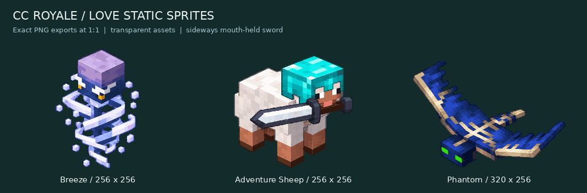

# LÖVE: Breeze, Adventure Sheep und Phantom

Drei echte transparente **statische Hauptposen** für das zukünftige LÖVE-Projekt. Ausgangspunkt ist die vom Nutzer freigegebene Konzeptansicht mit dem **seitwärts quer im Maul getragenen Eisenschwert**. Diamanthelm, vierbeiniger Schafkörper und seitliche Schwertorientierung bleiben erhalten.



| Sprite | PNG | Canvas | Anker (x, y) | Pose |
|---|---|---|---|---|
| Breeze | [breeze.png](breeze.png) | 256 × 256 | 128, 240 | schwebendes Idle |
| Adventure Sheep | [adventure_sheep.png](adventure_sheep.png) | 256 × 256 | 128, 240 | Idle mit Maulschwert |
| Phantom | [phantom.png](phantom.png) | 320 × 256 | 160, 240 | Flug-Hauptpose |

**Technik:** PNG RGBA, ausschließlich Alpha 0/255, transparentes RGB auf null, jeweils 48 sichtbare Farben, mindestens 16 Pixel Rand. Eigenständig ausgearbeiteter High-Res-Master, keine Vergrößerung der CC-Raster. Einheitliches Licht von links oben. Für scharfe Darstellung `nearest` und vorzugsweise ganzzahlige Positionen und Skalierungen verwenden. `index.lua` und `index.json` enthalten Dateipfade, Canvasgrößen und Anker; JSON zusätzlich tatsächliche sichtbare Grenzen und SHA-256-Hashes.

Die nullbasierten Anker beziehen sich auf die untere Mitte der Bildhülle, **nicht auf Augen, Kopf oder Kollisionskörper**. Beim schwebenden Breeze beziehungsweise Phantom ist dies eine gemeinsame projizierte Basis. Eine zukünftige Flug-/Höhenlogik kann einen separaten Draw-Offset verwenden. Der Anker verändert keine Gameplay-Koordinaten oder Hitboxen. Der Phantom erhält eine breitere Canvas statt abgeschnittener Flügel. Bei weiteren Posen pro Figur die zugehörige Canvas und denselben Anker beibehalten; seitliche Attacken können später eine größere einheitliche Clip-Canvas erfordern.

## In ein LÖVE-Projekt übernehmen

Den Ordner beispielsweise nach `assets/sprites/wind_sheep_phantom/` kopieren. Pfade im folgenden Beispiel an das eigene Projekt anpassen:

```lua
-- In love.load:
local folder = "assets/sprites/wind_sheep_phantom/"
local metadata = assert(love.filesystem.load(folder .. "index.lua"))()
local sprite = metadata.sprites.adventure_sheep
local image = love.graphics.newImage(folder .. sprite.file)
image:setFilter(metadata.filter.min, metadata.filter.mag)

-- In love.draw, mit gewählter Zeichenposition x/y:
love.graphics.setColor(1, 1, 1, 1)
love.graphics.draw(image, x, y, 0, 1, 1, sprite.anchorX, sprite.anchorY)
```

Dies sind etablierte LÖVE-11.x-APIs; eine Projektversion wird damit nicht vorgeschrieben. Hier steht weder ein separates LÖVE-Spielprojekt noch eine LÖVE-Laufzeit zur Verfügung. **Keine GPU-/LÖVE-Laufzeitprüfung behauptet.** Bestehende CC-Sprites, Spiellogik, Kartenregistrierungen, Balance und Installer werden nicht geändert. Die Quelldateien sind keine automatisch zu ladenden Spielressourcen.

## Quellen und Wiederholbarkeit

- `source/approved_concept.png`: freigegebene Konzeptansicht aus dieser Unterhaltung.
- `source/sprite_master.png`: separat mit dem Bildwerkzeug bereinigter High-Res-Master; gleiche Designs, seitliches Schwert.
- Die Minecraft-Vorlagen und Links stehen im übergeordneten [`evidence/references.json`](../evidence/references.json). Das Adventure Sheep ist ein eigener Entwurf auf Basis des Minecraft-Schafs; Breeze und Phantom orientieren sich an ihren Minecraft-Vorbildern.
- `tools/export.sh`: ImageMagick-7-Export mit expliziten getrennten Quellbereichen, Nearest-Neighbor, begrenzter Palette und binärem Alpha. Die generierte Quelldatei bleibt erhalten. Keine automatische Umsetzung der kleinen CC-Sprites.
- `tools/package.py`: Pillow-Prüfung und Vorschaukomposition ausschließlich aus den tatsächlich ausgelieferten PNGs. Keine unabhängig generierte Vorschau.

Aus diesem Ordner:

```sh
bash tools/export.sh
python3 tools/package.py
python3 tools/package.py --check
python3 tools/package.py --check --zip /tmp/cc_royale_love_sprites.zip
```

Diese Befehle wurden mit ImageMagick 7.1.1-43, Python 3.12 und Pillow 12.3 ausgeführt. Die Vorschau verwendet DejaVu Sans. Die freigegebenen Designs wurden durch Bildgenerierung ausgearbeitet; PNG-Export und Paketaufbau aus dem gespeicherten Master sind reproduzierbar, die Bildgenerierung selbst ist es nicht.

## Umfang und Grenzen

Fertig sind **drei verwendbare statische Einzel-Sprites**, Anker-Metadaten und eine echte Exportvorschau. Es gibt hier jeweils genau eine Hauptpose; keine vollständigen Idle-/Lauf-/Angriffs-/Hurt-/Death-Animationssheets, keine Richtungssets, keine Effekte oder spielbaren Karten. Die bereits vorhandenen CC-Animationsprototypen sind ein separates Format und werden nicht als LÖVE-Animationen ausgegeben. Visuelle Prüfung der Exporte erfolgte auf dem Host; keine Endgeräte- oder Ingame-Freigabe wird daraus abgeleitet.
