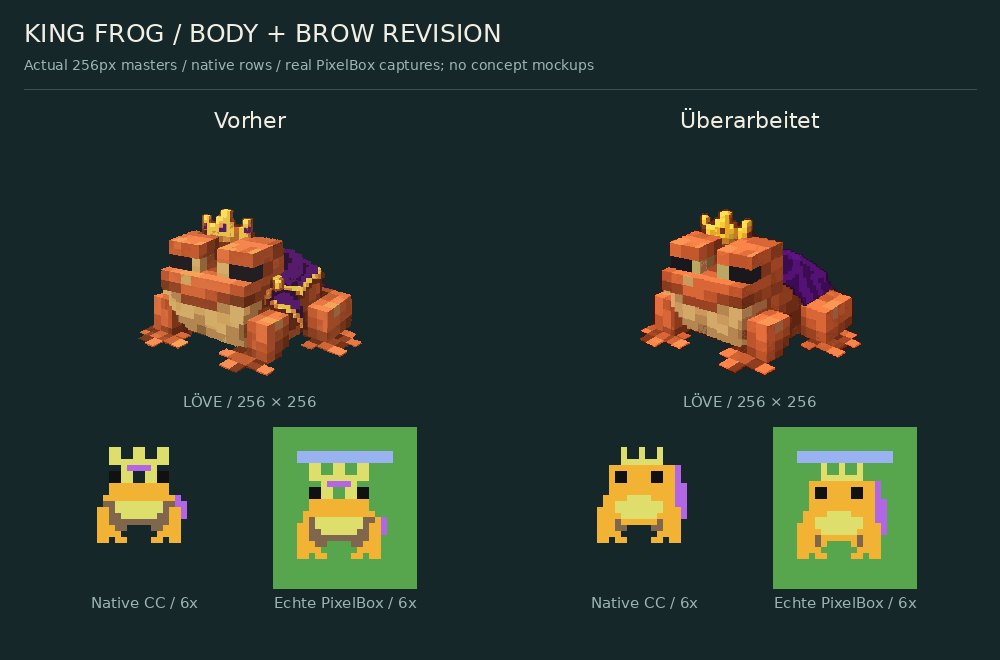
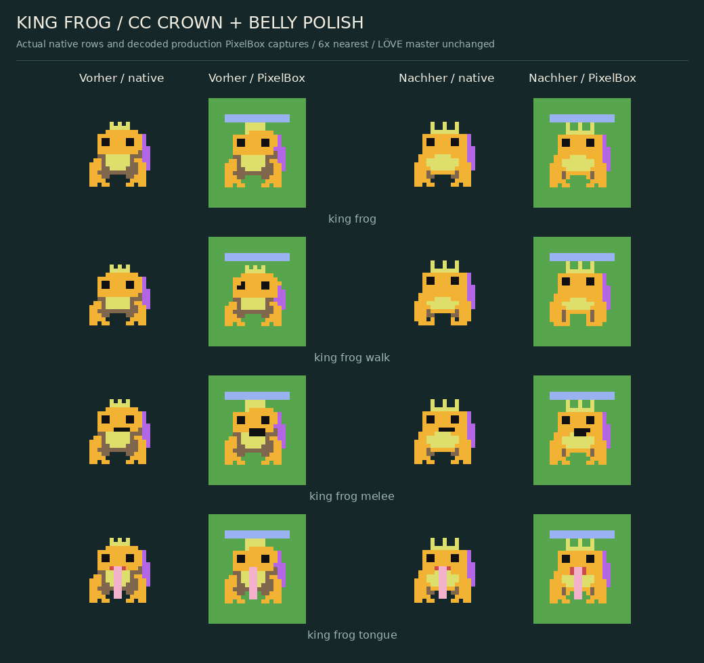
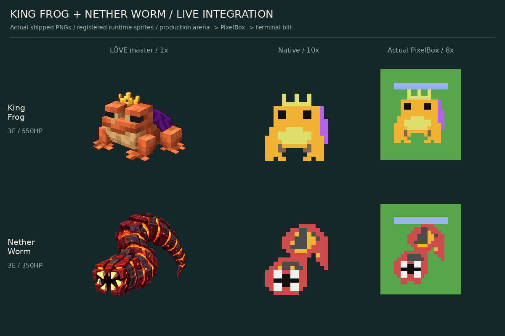

# King Frog and Nether Worm — shipped asset subset

Only these two custom mobs are registered by this implementation. Their original art derives from [PR #21](https://github.com/Chazammm/CC-Minecraft-Royale/pull/21), source revision `a0da310becfbdb028780ab698fa3d80a047e46a5`. King Frog was revised on 2026-10-16 as described below; Nether Worm is unchanged. There is no runtime dependency on that unmerged branch and no Crab/Centipede art in the runtime subset.

## King Frog body revision — 2026-10-16

The revised master and all four native poses have continuous orange skin above both eyes, a natural orange frog body with a pale tan belly, one small gold crown and one plain purple cape. The purple face band and decorative chest treatment are removed. No card statistics, abilities, rendering code or sprite dimensions change.



The independently edited design source is preserved at `source/king_frog_revision.png`. The 256×256 RGBA export retains the existing 40-color visible palette budget, transparent margins and foot anchor (128,240). Reproduce the technical export with `bash assets/sprites/frog_worm/tools/export_king_frog.sh` from the repository root, using ImageMagick 7.1.1-43. The script crops, fits and quantizes this source; it never enlarges native sprites. Existing LÖVE animation preparation remains unchanged; only the main pose is supplied.

`MANIFEST.json` records source and export hashes. `source/king_frog_before.png` and `source/king_frog_before_capture.json` preserve the actual previous master and renderer capture from implementation revision `5b6b89264e1a7591b2bc5a9a9e639baf28f25706`. The before/after sheet is composed from these files and the new real captures. The palette negative control now targets an unchanged Worm row so it remains independent of the revised Frog crown shape.

Initial revision validation (`f7193ff`, host, 2026-10-16): all 52 discovered Lua suites passed under both Lua 5.2 and 5.4 (104 runs), all eight Python tests passed, and all 11 isolated negative controls were detected under each Lua version. Fresh rendering captures passed 25,267 checks per version across 54 pose/view/size combinations plus the gameplay scene. Exact preview composition, binary alpha, transparent margins, palette budget, hashes and byte-reproducible master export passed. Worm native frames, master PNG and per-pose captures are unchanged from the audit base revision recorded in the manifest. Physical CC:Tweaked hardware remains unverified.

## Native crown and belly polish — 2026-10-16

The follow-up visual review found that PixelBox flattened the crown in three poses and that the brown belly border still resembled a bib. The crown now occupies the first three native rows, using only yellow and transparent terrain in that texel band. All four poses share the same three separated points and crown base. Orange skin starts in the next band; the walk animation moves the belly and feet without shifting the crown into a mixed-color band. This keeps the existing 16×16 dimensions, renderer and HP bar unchanged.

The pale belly now meets orange skin directly, with stepped edges instead of a brown outline. Brown is confined to rear-leg shading. The orange skin above the eyes, single crown and plain rear cape remain. Both LÖVE masters and every Worm raster and per-pose capture are byte-for-byte unchanged from `f7193ff`.



`source/king_frog_cc_before.json` preserves the four actual pre-polish captures from `f7193ff`; its hash and provenance are recorded in `MANIFEST.json`. The sheet is composed only from those prior captures and the newly rendered captures, using nearest-neighbor enlargement. All three separated crown points were verified in the decoded terminal output for each pose. Physical monitor appearance remains unverified.

Follow-up host validation: six relevant suites (Frog/Worm mechanics and rendering, existing sprite roster, frame diff, PixelBox failure recovery and four-mob rendering) passed under both Lua 5.2 and 5.4, for 12 successful executions. Fresh captures again passed 25,267 checks per Lua version. Exact compositions, cross-version capture equality, native/module hashes, PNG alpha and margins passed. Gameplay code and statistics are untouched.



[All nine registered native frames](previews/runtime_poses.png) · [Actual gameplay,6×](previews/gameplay_6x.png) · [Actual gameplay,1×](previews/gameplay_1x.png)

- Native Lua rows: `src/assets/custom_mobs/frames.lua`; dispatcher in the same folder. Frames stay within16×18 and use the original CC palette/dot transparency.
- Future LÖVE: `love2d/king_frog.png`, `love2d/nether_worm.png`;256×256 RGBA, one main pose each, nearest filter, foot anchor(128,240). Metadata in `love2d/index.lua`. These PNGs are independent reviewed design masters, not enlarged native rows; no complete LÖVE animation set is claimed.
- Native Frog: idle / crouched walk / tongue / melee. Worm: idle / move / bite / exposed emergence. Separate16×5 ground warning with owner cue has no entity or HP bar. Ordinary hurt, HP/team/web and death handling remain shared.
- `evidence/capture52.json` / `capture54.json` contain real registered renderer outputs, not injected preview slots. The gameplay scene contains an actual hook windup, an exposed Worm and a pending deployment.
- `tools/previews.py` composes only those captures and committed PNGs, and verifies exact pixel identity, cross-Lua equality, alpha/margins and master hashes. The original approved source-generation PNGs and animal reference links remain documented in PR #21.

Reproduce from repository root (host only; Lua5.2/5.4, Python3.12, Pillow12.3.0, DejaVu Sans):

```sh
lua5.2 tests/test_frog_worm_rendering.lua /tmp/frog-worm52.json
lua5.4 tests/test_frog_worm_rendering.lua /tmp/frog-worm54.json
python3 assets/sprites/frog_worm/tools/previews.py --check --capture52 /tmp/frog-worm52.json --capture54 /tmp/frog-worm54.json
```

[Runtime behavior and technical details](../../../docs/frog_worm/IMPLEMENTATION.md). CC installer ships only runtime Lua files; these PNGs, captures and host tools do not add in-match image loading or rendering work. Virtual-monitor images use square logical pixels; physical terminal-cell appearance and timing still need on-device review.
