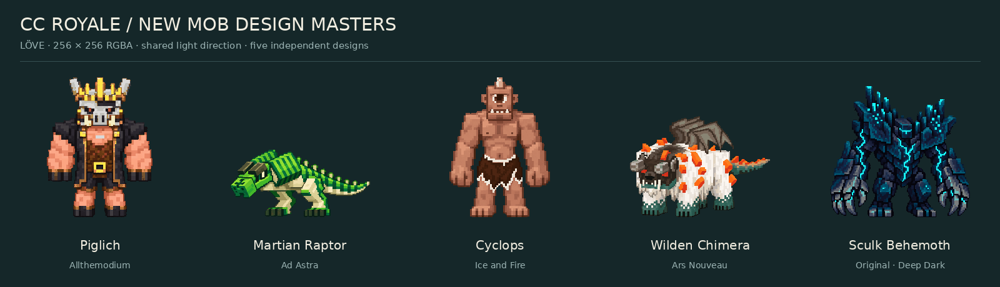
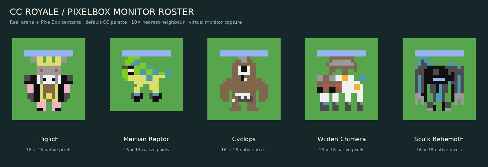

# Five mobs — dual-platform asset library

Second art pass after the [first visual audit](VISUAL_REVIEW.md),
**awaiting the owner's visual approval**.
Five original LÖVE design masters and five deliberately simplified CC rasters.
No card, runtime registration, gameplay code, installer entry or existing asset
is changed. Normal matches cannot select these five sprites.




[Revision 1 → 2 comparison](revision_comparison.png) · [Revision notes](REVISION2.md)
· [Full platform comparison](sprite_comparison.png) · [Native pixels, including 1× swatches](cc_native_roster.png)
· [2× master inspection](evidence/love_pixel_inspection.png)

## Files and dimensions

All paths in this table are relative to this directory. Native definitions are
plain returned tables in [`cc_tweaked/sprites.lua`](cc_tweaked/sprites.lua), keyed
by the IDs below; individual CC PNGs are exports, not runtime inputs.

| Name / ID | Origin | LÖVE RGBA | Opaque bounds (x, y, w, h) | Native CC |
| --- | --- | --- | --- | --- |
| Piglich / `piglich` | Allthemodium, associated with ATM10 | [256×256](love2d/piglich.png) | 43, 16, 169, 224 | [16×18](cc_tweaked/previews/piglich.png) |
| Martian Raptor / `martian_raptor` | Ad Astra | [256×256](love2d/martian_raptor.png) | 16, 132, 224, 108 | [16×14](cc_tweaked/previews/martian_raptor.png) |
| Cyclops / `cyclops` | Ice and Fire | [256×256](love2d/cyclops.png) | 47, 16, 161, 224 | [16×18](cc_tweaked/previews/cyclops.png) |
| Wilden Chimera / `wilden_chimera` | Ars Nouveau | [256×256](love2d/wilden_chimera.png) | 16, 78, 224, 162 | [16×18](cc_tweaked/previews/wilden_chimera.png) |
| Sculk Behemoth / `sculk_behemoth` | Original custom Deep Dark creature | [256×256](love2d/sculk_behemoth.png) | 16, 30, 224, 210 | [16×18](cc_tweaked/previews/sculk_behemoth.png) |

[MANIFEST.json](MANIFEST.json) records exact files, zero-based exclusive bounds,
palettes, per-mob source references and revisions, anchors and SHA-256 hashes.
[FILE_LIST.md](FILE_LIST.md) lists the complete delivery.

## Design and reference evidence

The approved roster pages in `assets/sprites/approved-model-revamp-*.webp`, the
existing native sprite roster and the user's `after.jpg` establish the colourful,
blocky, readable style. The revised humanoid masters face nearly forward with
broader, cleaner planes. The quadruped and raptor use shallow left-facing arena
views so their tails remain legible. They are
original interpretations, not copied mod textures or upscaled CC sprites.

The model and texture links below are pinned to the actual source revisions
inspected. Source-derived technical reference renders were used to inspect the
Piglich and Chimera. Java model geometry and texture layouts were also inspected
for the Raptor and Cyclops. These renders are reference aids, not shipped art.

| Mob | Primary reference | Identity carried into both platforms |
| --- | --- | --- |
| Piglich | [Allthemodium model](https://github.com/AllTheMods/AllTheModium/blob/1d39a7cbbe7b69769bd28f09b758a3cdfa47167e/src/main/resources/assets/allthemodium/geo/piglich_anim.geo.json), [texture](https://github.com/AllTheMods/AllTheModium/blob/1d39a7cbbe7b69769bd28f09b758a3cdfa47167e/src/main/resources/assets/allthemodium/textures/entity/piglich.png), branch `1.21.x` | Grey boar/skull head, red eyes, pale tusks, gold crown, salmon arms, charcoal shoulders/coat and gold trim. Broad planted stance replaces the reference model's crossed rest legs. No invented weapon. |
| Martian Raptor | [Ad Astra model](https://github.com/terrarium-earth/Ad-Astra/blob/45abf0ec05ea837c3df457f42ae440b6675e9cf0/src/main/java/earth/terrarium/adastra/client/models/entities/mobs/MartianRaptorModel.java), [texture](https://github.com/terrarium-earth/Ad-Astra/blob/45abf0ec05ea837c3df457f42ae440b6675e9cf0/src/main/resources/assets/ad_astra/textures/entity/mob/martian_raptor.png), branch `1.21.1` | Broad low striped side-head blocks, dark olive brow plates, angular green snout, pale belly and bent hind legs, dark toe/claw marks and a clearly separated ridged tail. |
| Cyclops | [Ice and Fire model](https://github.com/AlexModGuy/Ice_and_Fire/blob/02b2922003cbce3c67dad55dfea79acf1721e0db/src/main/java/com/github/alexthe666/iceandfire/client/model/ModelCyclops.java), [texture variant 0](https://github.com/AlexModGuy/Ice_and_Fire/blob/02b2922003cbce3c67dad55dfea79acf1721e0db/src/main/resources/assets/iceandfire/textures/models/cyclops/cyclops_0.png), branch `1.18.2` | One large eye, short central horn, bare tan body, long heavy arms, projecting toothed jaw, ragged brown loincloth with pale edge. No equipment added. |
| Wilden Chimera | [Ars Nouveau model](https://github.com/baileyholl/Ars-Nouveau/blob/fd8c9520722bb96a3e75febaf770d7078db5ac43/src/main/resources/assets/ars_nouveau/geo/wilden_chimera.geo.json), [texture](https://github.com/baileyholl/Ars-Nouveau/blob/fd8c9520722bb96a3e75febaf770d7078db5ac43/src/main/resources/assets/ars_nouveau/textures/entity/wilden_chimera.png), branch `main` | Single dark horned face, red eyes, white four-legged body, orange spikes, green/teal lower legs and tail, folded brown wing mass. The source model has four legs and configurable horns, wings and spikes. This is an equipped ground pose with folded wings, not a multi-headed fantasy chimera. |
| Sculk Behemoth | Original design for this library | Recessed slit head, uneven sculk growths on broad shoulder plates, massive clawed forearms, short legs and a cyan chest fracture. Distinct from the Warden's antennae and exposed ribcage. |

**Reference limits and interpretation:** these are the pinned upstream versions,
not a verification of the user's installed ATM10 jars/resource packs. The Raptor
source explicitly labels its model “legacy”; future replacements may differ.
Revision 2 uses an additional [secondary in-game view](https://www.minecraft-guides.com/mod/ad-astra/wiki/mars/)
([image](https://www.minecraft-guides.com/wp-content/uploads/2026/06/AdAstraMod_Raptor-1024x576.png))
to cross-check head proportions and posture against the primary geometry.
The previously unverified front clawlets are removed, tall head sails are
replaced with lower box-like forms, and feet are dark green rather than large
ivory talons. The screenshot does not verify the user's installed pack.
The CC Raptor keeps a compressed but distinctly horizontal head/body/tail
arrangement and two separate hind feet. The Cyclops uses one
uninjured texture variant; other variants are not represented. The Chimera's
far fourth leg is partly occluded in the master's three-quarter pose; all four
feet are explicit in CC rows. The Behemoth's entire anatomy is custom.

## Colour and pixel contracts

LÖVE files have binary alpha (0/255), zero RGB in transparent pixels, no embedded
background, no text and at most 40 opaque colours per design. They preserve fine
pixel clusters at 256×256. Export is nearest sampled without dithering or blur.
The design sources were made independently with the image-generation tool;
[source/README.md](source/README.md) explains provenance and the reproducible
technical export. No claim of hand-painted source pixels is made.

CC tokens exactly match `src/pixel_arena.lua`:
`K W S D G L B A C R Y N P M O I`; `.` is transparent. No custom palette is
installed. Each sprite uses a subset recorded in the manifest. Team identity
uses the existing HP bar, not recoloured creature anatomy. Piglich uses pink
skin, small red eyes and a pale snout/tusk region. Cyclops uses brown skin
without pink torso spots; its skin/cloth shading is limited by the palette.
Raptor dark teal stripes are approximated with cyan, and its feet use dark
grey/black with a small cyan edge. Chimera has dark grey paws with a thin cyan
(`C`) rim, replacing the first pass's large cyan foot blocks. Native green
(`G`) is also arena grass, so using it alone would hide these feet.
Behemoth dark grey/black planes add limb mass; narrow cyan/light-blue clusters
preserve its visor, arm veins and chest fracture. No sprite exceeds 16×18.

PixelBox retains only two colours per 2×3 terminal cell. It can merge small
claws, crown points, fur or stripes. The monitor preview is decoded from the
actual arena renderer's emitted sextant characters and foreground/background
bytes, on a 51×40 virtual terminal with the real terrain and HP bar. It is not
an independently painted concept. Both Lua versions display identical pixels
for the five central preview captures. Tests also exercise 45×42 and 57×62
terminals and both viewing players. Preview magnification preserves square
logical pixels; physical monitor cell aspect and palette settings may differ.

## Anchors and future animation

All LÖVE canvases use the **zero-based foot anchor `(128, 240)`**. Each sprite
has at least 16 pixels of canvas margin. Content is fitted inside 224×224 with
the same foot line; the Raptor is naturally wider and shorter. All current
opaque bounds end at the exclusive y=240 foot line.
Use [`love2d/index.lua`](love2d/index.lua) for the single-frame metadata:

```lua
local index = require('assets.sprites.new_mobs.love2d.index')
local spec = index.piglich
local image = love.graphics.newImage('assets/sprites/new_mobs/love2d/' .. spec.file)
image:setFilter('nearest', 'nearest')
-- Draw at a visual ground point; choose scale independently of world hitboxes.
love.graphics.draw(image, x, y, 0, scale, scale, spec.anchorX, spec.anchorY)
```

This is a usage example, not installed game logic. CC keeps the existing
centre anchor `(width/2, height/2)`, snapped by the renderer to its 2×3 cell grid.
Do not substitute the LÖVE foot anchor for current gameplay coordinates.

Only the `idle` image exists. Future `movement`, `attack`, `hurt` and `death`
frames can be stored beside these PNGs or packed into an atlas with matching
256×256 frame rectangles and the same anchor. No animation timings, dispatcher,
abilities, hitboxes or combat behaviour are defined here. The masters are flat
PNGs, not separated limb layers; animation still needs additional artwork.

## Reproduce

From repository root, with Lua 5.2/5.4, Python 3.12, Pillow 12.3.0 and DejaVu Sans:

```sh
lua5.2 assets/sprites/new_mobs/tools/test_assets.lua /tmp/new-mobs-52.json
lua5.4 assets/sprites/new_mobs/tools/test_assets.lua /tmp/new-mobs-54.json
python3 -W ignore::DeprecationWarning assets/sprites/new_mobs/tools/validate_assets.py --capture52 /tmp/new-mobs-52.json --capture54 /tmp/new-mobs-54.json
```

After intentionally editing art, rebuild in this order:

```sh
python3 assets/sprites/new_mobs/source/author_cc.py
python3 -W ignore::DeprecationWarning assets/sprites/new_mobs/tools/export_love.py
lua5.2 assets/sprites/new_mobs/tools/test_assets.lua assets/sprites/new_mobs/evidence/pixelbox_lua52.json
lua5.4 assets/sprites/new_mobs/tools/test_assets.lua assets/sprites/new_mobs/evidence/pixelbox_lua54.json
python3 assets/sprites/new_mobs/tools/render_previews.py
python3 -W ignore::DeprecationWarning assets/sprites/new_mobs/tools/build_manifest.py
```

The host-only renderer test temporarily injects a private preview slot through
native Lua `debug.getupvalue`, restores it after errors, and never registers a
card. CraftOS does not need or run this harness. Importing either art data module
needs no `colors` global, PNG decoder or host dependency. Neither module is
imported by normal startup or added to the installer.

[VALIDATION.md](VALIDATION.md) records regression results, synthetic performance
observations and the remaining physical-monitor/visual approval limitations.
