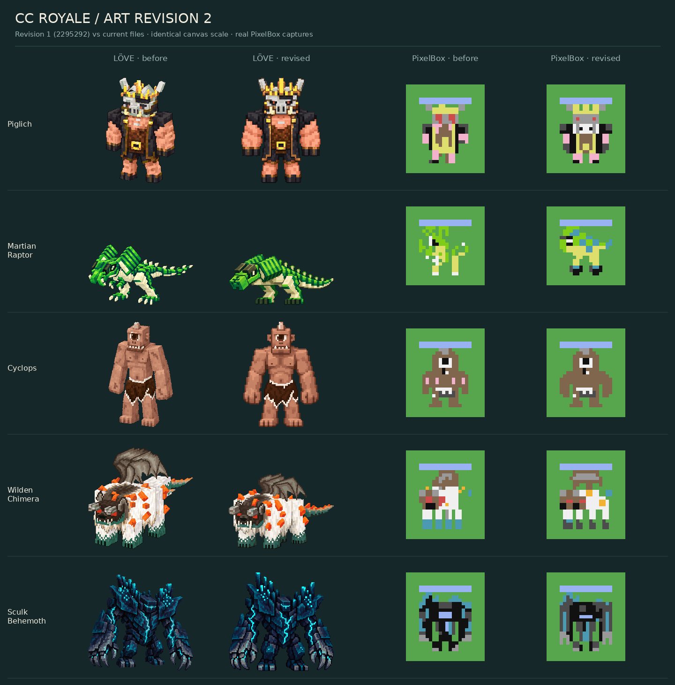

# Art revision 2 — corrective pass

The owner requested revisions after the [first visual review](VISUAL_REVIEW.md).
All five LÖVE masters and all five native CC sprites were updated. This is a
new art candidate for visual approval; technical passes are not art sign-off.

The left columns use exact exported files from `2295292`; the right columns use
the current files. The LÖVE images keep their original 256×256 canvas scale;
the terminal crops use identical nearest-neighbour magnification. No concept
image is substituted for an actual asset. The preserved first-pass inputs
are checked byte for byte against Git.

| Review finding | Revision applied | Remaining visual limit |
| --- | --- | --- |
| Piglich face/crown reduced to red/yellow blocks | Frontal master with small red eyes, prominent snout and tusks, broader shoulders and narrow coat trim. Native head is rebuilt with two visible nostrils, separated pale tusks and three crown tips; eyes are two small pixels. | The palette still simplifies grey/gold materials and boot edges. |
| Raptor too upright; tail weak; interpreted anatomy | Master cross-checked with primary geometry plus an additional secondary in-game screenshot. Unverified front arms removed, head sails lowered to box-like plates, dark toes replace ivory talons. CC reallocated to a lower 16×14 silhouette with a longer visible tail and two hind feet. | Raptor is intentionally wider/shorter on the shared master canvas. Small stripe and toe details still merge in terminal cells. Exact installed-pack fidelity is unverified. |
| Behemoth lacked mass in CC | Master is more frontal with clean broad shoulder planes. Native shoulders/forearms are solid dark planes, the visor is narrow, cyan arm veins and a longer chest fracture survive encoding, and pale hooked claw tips extend farther. | Native grey substitutes for very dark navy. Fine shell plates and individual fingers remain reduced. |
| Chimera wing/spikes/paws | Master has cleaner fur planes and a lower folded wing mass. CC uses a broad membrane and angular downward folds, two larger orange spike clusters, and dark paws with a narrow cyan rim instead of tall cyan blocks. | A 16-pixel figure cannot retain the master's wing ribs. Physical monitor review is still needed to judge the fold silhouette. The master's far fourth leg is partly occluded. |
| Cyclops spotted skin and weak hands | More frontal, broader master with larger fists and restrained skin planes. CC removes all pink spots and widens the arms/hand silhouettes while retaining the single eye, horn and ragged hide. | The native skin has very limited shading because of the fixed palette. |
| LÖVE style continuity | Humanoids are frontal with clearer large planes; the Raptor and Chimera retain shallow left-facing views to expose the tail and quadruped anatomy. Surface noise is reduced. | Masters still have more detail and depth than the original roster; final stylistic acceptance belongs to the owner. |

## Reference correction

The additional Raptor view is a secondary screenshot from
[Minecraft Guides, Mars](https://www.minecraft-guides.com/mod/ad-astra/wiki/mars/)
([image](https://www.minecraft-guides.com/wp-content/uploads/2026/06/AdAstraMod_Raptor-1024x576.png)),
accessed 2026-10-15. Its low broad head plates, dark brow pads, two bent pale
hind legs and dark feet corroborate the correction. The primary pinned Java
model/texture references remain in the README/manifest. A missing forelimb bone
name alone is not used as proof of anatomy. No secondary screenshot is shipped
with the library.

## Technical verification

- Five 256×256 RGBA masters, 40 opaque colours each, binary alpha, clean RGB in
  transparent pixels, at least 16 px canvas margins and one connected silhouette.
- Native dimensions: 16×18, 16×14, 16×18, 16×18, 16×18. No renderer or envelope change.
- 20,916 assertions under each Lua version, including 30 real-renderer cases.
- 150 Python checks including exact regenerated previews, preserved old-file
  provenance, cross-Lua displayed-pixel parity and targeted repaired cues.
- All 94 existing Lua suite runs pass again; state and original registries remain
  intact. [Validation](VALIDATION.md) records the full scope and hardware limits.

All changes stay inside this inactive asset library and its host QA. No card,
stats, ability, hitbox, coordinate, renderer, cache or game-system change is
included. Physical CC:Tweaked hardware and owner art approval remain pending.
