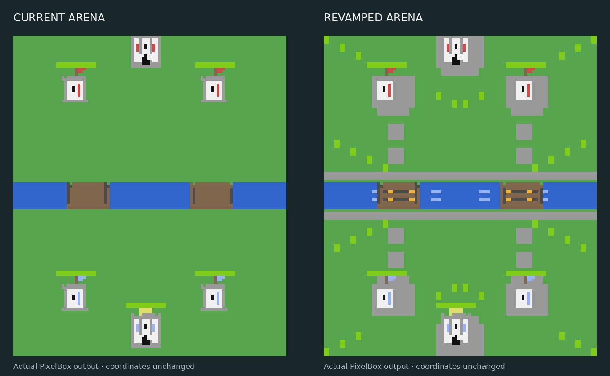

# Arena appearance: fixed coordinates

The arena now has sparse grass highlights, stone tower foundations and stepping
paths, stone banks, water wavelets, and wooden bridge grain. These are background
colours only; they add no obstacles, entities, deployment rules or collision.



These images come from the real PixelBox renderer on a virtual monitor. They
are native game output, rather than an illustration of a different map.

| Geometry | Preserved value |
| --- | --- |
| World size | 100 × 160 |
| River | y = 74 through 86 |
| Bridge centres | x = 27 and 73 |
| Bridge half-width | 7 (x = 20–34 and 66–80) |
| Princess towers | x = 25/75, y = 132 for player 1 and 28 for player 2 |
| King towers | x = 50, y = 151 for player 1 and 9 for player 2 |
| Monitor, arena and card touch rectangles | Original layout calculations |

Only `drawTerrain` in `src/pixel_arena.lua` changes at runtime. The original
river and bridge drawing is retained. Decoration is confined to complete,
solid 2×3 PixelBox cells: mixed boundary and rail cells retain their original
pixels. This preserves land, water and bridge footprints both before and after
terminal encoding. Every colour used within an interior cell belongs to that
cell's original terrain class. Grass details avoid tower health bars.

Paths and foundations use the existing `arena.towerBlueprints()` coordinates.
The paint is cached with the existing terrain cache. It uses no random numbers
and adds no per-tick terrain painting. Existing sprites, coordinate transforms,
collision, navigation, deployment, touch handling and gameplay files are unchanged.

`tests/test_arena_skin_parity.lua` checks 314,874 terrain pixels and 68,034
coordinate cases at four monitor sizes, including both player perspectives.
A deliberately widened bridge proves the geometry oracle rejects drift. It
also compares 240 seeded combat ticks with no rendering, the previous terrain,
and the new skin: movement, health, targets, spells, economy and RNG match.

All 65 Lua files compile and all 33 Lua suites pass locally in Lua 5.2.4 and
Lua 5.4. The four Python retention tests pass. CI runs the new parity check in
both Lua versions. No coordinate or gameplay regressions were found in these
checks. Physical CC:Tweaked/ATM10 display quality and throughput remain untested.

After merge, update the arena computer using the normal installer:

```text
wget run https://raw.githubusercontent.com/Chazammm/CC-Minecraft-Royale/main/install.lua
diagnose
main
```
