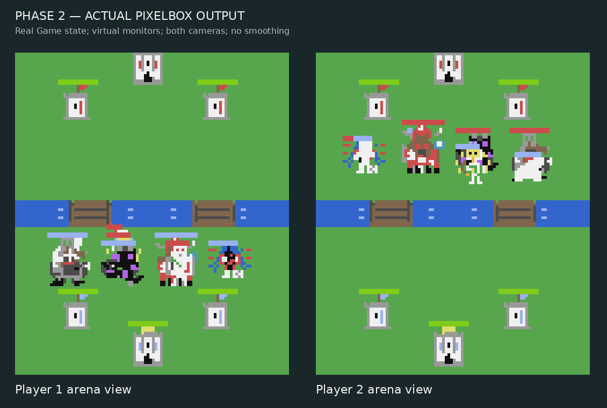

# Four mobs and Hero Spider — Phase 2 integration

Implemented after explicit Phase-2 authorization. Source commit: `e53ad48a22dbdb2bc519b3577a70302cc136f960`, exact Git tree `22577a3d6a4db92c638881e9a8c87ae8d3982a0c`. CLI evidence is stamped with this tree; the final documentation commit preserves those runtime/test files. Raw evidence and SHA-256 source hashes are in [the evidence directory](four_mobs_phase2_20261014/manifest.json).

## Implemented behavior

| Unit | Cost | HP | Damage | Attack interval | Range | Speed |
| --- | --- | --- | --- | --- | --- | --- |
| Ravager Rider | 5 | 1300 | 220 primary / 20 rider | 3s / 2s | 3 / 15 | 4.4 |
| Baby Ender Dragon | 5 | 600 | 70 splash | 1.8s | 14; splash radius 4 | 5.2 |
| Minoshroom | 8 | 2100 | 300 single-target | 2.4s | 2.5 | 3.6 |
| Hero Spider | 2 | 275 | 38.76 | 0.8/1.02 = 0.78431372549s | 2.2; web range 12 | 10.5 |

Ravager is one HP/movement/entity record with a building-only primary lock and an independent ground/air troop-only rider lock. It fires while moving or attacking a building. First building impact happens immediately on reaching range, exactly once per entity lifetime; retargeting cannot repeat it. Primary values derive once from the actual Iron Golem definition, rather than duplicating its balancing constants.

Dragon reuses the authoritative flying/projectile/splash engine. Minoshroom reuses ordinary ground melee: an unmodified Zombie has 523 HP, retains 223 HP after one real hit, and dies on the second. Air targets are excluded and adjacent troops take no splash.

Hero Spider uses existing cycle-2 semantics: two successful normal Spider plays, then the evolved third play. HP/damage multipliers and the attack interval derive from the normal Spider. Fractional attack progress is scoped to Hero and webbed units; ordinary existing units retain their approved tick rounding.

**Web starts ready at spawn**, then launches are 10 seconds apart. Phase 1 had proposed an initial ten-second charge; the first full matches showed some Heroes dying before using it. A preference question was offered, and the stated default was immediate readiness while continuing work; no alternative was supplied. Web has its own clock, reserves one valid target atomically, and applies one permanent entity-owned status at impact. Ground enemy troops only: no air, water-only Dev mobs, structures, towers, castles, already-webbed or reserved targets. Invalid in-flight targets release/refund the matching shot. Movement and ordinary attack frequency become 25%; source death does not remove the status. Temporary movement slows use the strongest local factor; the existing global aura then multiplies separately. Ability/spawner/fuse timers are not ordinary weapon frequency clocks.

## Integration and isolation

- Three new selectable cards; Spider gains one Evolution. Pool is 25 selectable cards, 26 including Dev Guardian; six production Evolutions and seven including Elder Guardian.
- Native asset copies in `src/assets/four_mobs/`: all 25 character frames and 15 effects exactly preserve the approved pixels. Live frame selection, projectiles, hits and permanent-web markers are registered. Walking follows actual movement; flight uses the prepared frame sequence. Both cameras use the same game presentation clock.
- Bot sums the concurrent Ravager weapon channels, recognizes anti-air/support roles, shares effective movement/attack modifiers, and can save for the new 8E tank from the normal 5E opening. Existing default decks and old-card scoring values remain unchanged.
- Installer explicitly includes all new Lua modules and asset files. No PNG/GIF or Phase-1 host tool becomes a runtime dependency.
- Live/headless simulation still shares Game and Bot. Rendering fields are excluded from combat snapshots; status, reservations and shot allocator remain observable.
- Arena geometry/configuration, 8-card decks, empty boot decks, three presets, disabled-Evo behavior, economy, tower values and Dev-only Guardian restrictions are preserved.

## Findings corrected during integration

1. The legacy reset-to-interval clock would swallow the Hero +2% frequency at the production 0.1s cadence. Scoped fractional progress preserves the requested rate, without globally changing old attack cadence.
2. Competing Heroes could otherwise issue duplicate nets. Source/target reservations, impact revalidation and matching-token refunds prevent stacking and stale transactions.
3. Final removal initially retained status on discarded entity objects, while match end retained pending net reservations. Both failures were reproduced before fixing. Explicit purge/cancellation now covers death, admin clear, reset, result and tiebreaker.
4. The existing host CI excludes the Phase-1 asset directory. Renderer regressions therefore use an immutable independent approved-pixel fixture under `tests/fixtures`, not a missing runtime/preview dependency.
5. Ready-but-unusable nets could otherwise permanently select a charge pose instead of walking. Charging presentation now requires an imminent valid shot; it does not affect gameplay decisions.

## Verification

| Check | Result |
| --- | --- |
| Lua 5.2/5.4 syntax and all 47 Lua suites per version; five Python tests | PASS: 99 runner entries, zero failures |
| Full in-game mechanics framework | PASS: 75/75, including 43 new real-engine cases |
| Native art preservation and actual live dispatch | PASS: all 40 approved frames; 150 character captures across 3 sizes × 2 cameras; registered projectile/effect paths; cache/forced parity and no ghosts |
| Full live driver vs shared headless runner | PASS: exact checkpoints/final state, bot actions and deterministic replays for two full new-unit matches per Lua version |
| 1,000 mixed-deck full-engine invariant matches, seed 20261014 | PASS: 2,698,823 ticks; P1 501 / P2 497 / draws 2; no timeout or invariant violation |
| 100-match cross-Lua seeded replay | PASS: P1 50 / P2 50 / draws 0; 267,182 ticks; identical fingerprint 1216322018 |
| Additional mixed balance run | PASS: 100 matches, 50/50 side outcomes |
| Controlled replacement/Evo comparisons | PASS: four comparisons × 25 contexts × 4 real matches = 400 matches |
| Post-GC native Lua 5.2 memory across 1,000 matches | Observed 521.32–521.82 KiB, no growing retained-state trend in this run |
| Additional integration review and regression pass | PASS: no further relevant finding after fixes |
| Physical CC:Tweaked/Cobalt monitors, actual ATM10 latency and manual PvP | NOT TESTED |

The state observer now detects invalid/duplicate shot IDs, orphan reservations, invalid permanent-status factors and nonfinite weapon clocks. It does not replace physical testing or prove every possible state.

## Balance findings, without further tuning

Paired score differences, not pure card duel winrates:

| Comparison | Observed difference | Paired 95% interval |
| --- | --- | --- |
| Hero slot vs no Evo slot | Hero +8 pp | -8.51 to +24.51 pp |
| Rider vs Iron Golem, both 5E | Rider -16 pp | -41.78 to +9.78 pp |
| Dragon 5E vs Blaze 4E | Dragon +20 pp | -0.64 to +40.64 pp |
| Minoshroom 8E vs Iron Golem 5E | 0 pp | -23.83 to +23.83 pp |

All intervals cross zero; the latter two comparisons also have different costs/roles. These samples do not establish that the cards are balanced or overpowered. Minoshroom is played less often because of its 8E cost. Hero reached its Evolution in every controlled Evo match. Existing mixed-run WATCH flags are recorded in the raw report; no old-card tuning or weakening of the requested permanent web was performed.

## Actual virtual-monitor capture

This is the real Game/PixelBox path, not a conceptual painting or an in-Minecraft hardware screenshot:

**PHASE 2: IMPLEMENTED AND AUTOMATED-TESTED. FIELD VALIDATION: NOT TESTED.**
