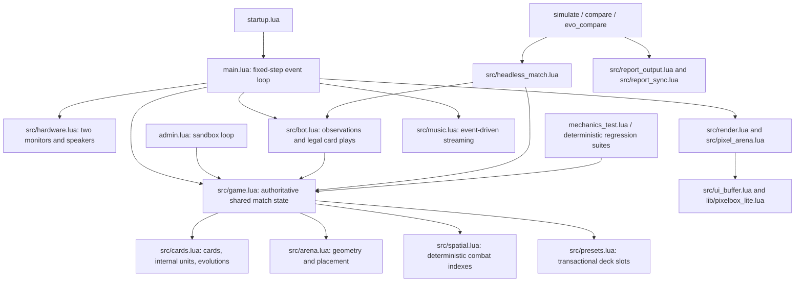

# Vollständiger technischer System-Audit — 2026-10-14

Baseline commit: `c9b4796d7651a391d647ca6316937744b21dc047`.
All 155 tracked files were inventoried and their bytes checked against Git blob
SHAs. The isolated baseline has 65 Lua files, two Python files, two workflows,
16 Markdown files, 61 text files, seven binary art assets and two dotfiles.
Generated historical reports are evidence, not proof of current behavior.

## Architecture and authority



One computer owns state; the two monitors are mirrored views of that state,
not independent multiplayer replicas. No modem-message or redstone game-state
protocol exists. Wired peripherals provide monitor/speaker access.

The normal loop handles touch, resize, peripheral, audio/HTTP and timer events.
Ticks use a bounded fixed-step accumulator (five maximum catch-up steps).
`Game.update` performs economy, pending spells, entity combat/lifecycle,
projectiles, effects and match transitions; bots act after it. Headless matches
share those rules and intentionally omit cosmetics/preset IO only. Simulation
bot scheduling alternates order and side-swapped contexts compensate orientation.

Current rules preserved: 22 selectable cards, eight-card decks, empty boot
selection, three preset slots per player, separate selected Evo, global Evo
switch, five production Evos, and dev-only Guardian/Elder Guardian. Each side
has two Princess Towers and one King Tower. King Towers already attack by range
from battle start; a separate dormant-castle activation rule is not implemented.
The configured Vex cap is 30 damage **per hit**, with 9s lifetime and 0.8s attack
cooldown. Ground navigation uses bridges; flying units cross water; Enderman's
explicit teleport ability is a separate mechanic. Tower destruction unlocks
only the matching enemy deployment pocket.

## Ergebnis und Umfang

**22 zusätzliche Fehler/Risiken im Ausgangsstand wurden behoben, außerdem ein
im Folge-Audit gefundener Kompatibilitätsfehler des neuen Diagnosewerkzeugs.**
Alle 23 Einträge AF-039 bis AF-061 enthalten Ursache, Reproduktion, Änderung
und Testverweis im [Audit-Register](AUDIT_REGISTER.md). P1 entspricht HIGH,
P2 MEDIUM. Kein neuer P0/CRITICAL-Fall wurde bestätigt.

Die [Datei-Abdeckung](SYSTEM_AUDIT_FILE_COVERAGE_20261014.json) enthält jede
der 155 ursprünglichen Dateien mit Git-Blob-SHA und Prüfart, außerdem die neuen
Quellen und Tests. Historische Reports wurden auf Format, Revision und
Fehlermarker geprüft; Bilddateien auf Integrität und ihre Beziehung zu den
Renderer-Fixtures. Solche Artefakte sind keine ausführbare Spiellogik und
werden nicht als aktuelle Testergebnisse ausgegeben. Der finale Quellstand
enthält **80 Lua-Dateien und 44 Lua-Testsuiten**.

## Behobene Fehler und Ursachen

| Bereich / IDs | Ursache und tatsächliche Korrektur |
| --- | --- |
| Match-Ende: AF-039, AF-060 | Nach einem gewinnenden Projektil wurde das nächste Projektil noch verarbeitet; nach einem gewinnenden verzögerten Anvil liefen Aura-/Combat-Stufen weiter. Beide Stufen stoppen jetzt an ihrem terminalen Übergang. |
| Seitensymmetrie: AF-040, AF-053 | Swarm-/Summon-/Split-Offsets waren absolute Weltvektoren. Tower-, Bridge- und Mittellinien-Ties sowie Villager-Variation wählten für beide Besitzer dieselbe Weltseite. Owner 2 erhält die entsprechenden gespiegelten Vektoren und deterministischen Tie-Regeln. |
| Timer: AF-055 | Positive IEEE-754-Reste erzeugten ganze zusätzliche Ticks: Zombie 1,1 statt 1,0s, King 1,0 statt 0,9s, verspätete Lebensdauer/Spawns/Countdown/Regulation und einzelne Bot-Denkintervalle. Ein gemeinsamer Decrement-Helper entfernt nur Reste bis 1e-9s; echte Tick-Quantisierung bleibt erhalten. |
| Wasser-Targeting: AF-056 | Eligibility maß bis zur Flussgrenze, Pathing hielt 0,01 Einheiten davor. Ground Units konnten ein mathematisch unerreichbares Wasserziel behalten. Reichweitenprüfung und Navigation verwenden jetzt denselben begehbaren Punkt und dieselbe numerische Toleranz. |
| Eingangsgrenzen: AF-041, AF-042, AF-046 | Nichtendliche dt-/Slow-/Spawn-Werte konnten Zustand vergiften oder spät crashen; die Emerald-Toleranz ließ kleine negative Guthaben zu. Frühzeitige Guards und ein begrenzter Debit verhindern das ohne neue Preise. |
| Headless-/Replay-Vertrag: AF-043–045, AF-050, AF-059 | Ungültige dt änderten schon den Lobby-Zustand; Countdown 0 wich von Live ab; ein Lua-Ternary emittierte Headless-Sounds; technische Timeouts wurden als Draw gewertet; Seeds/Offsets wurden zu spät geprüft; ungültige Decks still ersetzt. Validierung liegt vor RNG/State/Report-Mutation, Timeouts sind Fehler und Live-Übergänge werden exakt reproduziert. Seed-Offsets werden vor Addition modular reduziert. |
| Admin: AF-047 | Unterstützte direkte Positionsedits ließen Spell-Spatial-Buckets bis zum nächsten Tick veraltet. Der Spell-API-Einstieg reconciled sie jetzt sofort. |
| Mechanics-Framework: AF-048 | Eine gefangene Test-Exception konnte globale Karten-/Config-Definitionen für spätere Fälle verändert hinterlassen. Jeder Fall bekommt eine Restore-Grenze, die Werte und ursprüngliche Tabellenreferenzen auch nach ERROR wiederherstellt. |
| Monitor-/Event-Fehler: AF-051, AF-054, AF-058 | Kleine Layouts enthielten unsichtbare Touch-Zonen; ein fehlgeschlagener Blit konnte als aktueller Frame gelten; queued Touch nach Detach umging die Render-Guards. Größen-Fallback, Cache-Invalidierung und geschützte Layout-Akquisition erlauben Wiederherstellung ohne Gameplay-Mutation. |
| Optionales Audio: AF-057 | Lokale Open-/Seek-/Read-/Metadaten-Exceptions konnten das Hauptprogramm beenden; Pending-Audio ignorierte Retry-Backoff. Fehler bleiben jetzt im optionalen Musiksystem, mit begrenzten Wiederholungen. |
| GitHub-IO / Retention: AF-049, AF-052 | HTTP-/JSON-Exceptions konnten Handles offen lassen; ungültige verschachtelte Antwortformen erreichten Branch-Writes. Ein Rebase alter Retention-Deletions konnte neu gepinnte Reports löschen. Antworten werden geschlossen/validiert; nach einer Push-Race wird aus aktuellem main neu geplant, ohne Force-Push. |
| Neues Diagnosewerkzeug: AF-061 | Die erste Version nahm natives collectgarbage an. Der zusätzliche Audit prüfte Cobalt BaseLib: dieser API fehlt dort. Fehlende/eingeschränkte GC wird jetzt toleriert und Memory als unavailable angezeigt. os.clock wird ausdrücklich als native CPU-Zeit bzw. CraftOS-Uptime beschriftet. |

CRITICAL/HIGH wurden zuerst bearbeitet. Schutzfälle gegen absichtlich kaputte
APIs sind als RISK markiert; sie werden nicht als auf einem realen Server
beobachtete Abstürze beschrieben. Fehlgeschlagene Vorher-Checks sind in
[red_before_fix.txt](audit_20261014/red_before_fix.txt) archiviert.

## Gameplay und Datenkonsistenz

Target Lock bleibt ab erster gültiger Acquisition bestehen. Tod,
Targetability-/Reichweiten-/Terrain-Invalidität sind erlaubte Retarget-Gründe;
neu gespawnte Gegner stehlen kein gültiges Ziel. Tower-Tests erfassen beide
Typen und Besitzer, einschließlich Verlust der Reichweite und Tod.

Gebäude verlieren HP kontinuierlich nach `maxHp/lifetime * decayMultiplier`;
Gegnerschaden addiert sich dazu. Normale zeitlich begrenzte Units behalten ihren
Despawn-Vertrag. Stomp-Zeit läuft nur für tatsächlich zurückgelegte Bewegung;
Flying und Water-only bleiben ausgeschlossen. Creeper-Fuse, Charged Creeper,
Skeleton-Kiting, Portal/Piglin/Ghast, Witch, Blaze, Snow Slow, Villager,
Evoker/Vex, Mite, Outpost/Cannon und Spell-Radien werden im tatsächlichen Game
geprüft. Der Vex-Test misst echten Hit-Schaden von 30, statt nur ein Feld zu
vergleichen; 30 ist keine gesamte Lifetime-Damage-Grenze.

Evo-Zähler, separate Slot-Auswahl, globale Deaktivierung, Bot-Auswahl,
Dev-Spawns und Reset wurden gegen die aktuelle Implementierung geprüft.
Guardian/Elder Guardian bleiben Dev-only. Presets speichern Decks, nicht eine
zusätzliche Evo-Auswahl; die drei Preset-Slots sind laut README bewusst
UI-hidden. Ein Boot startet mit leerem Deck.

`src/cards.lua` und `config.lua` sind **byte-identisch zum Ausgangsstand**:
keine HP-, Damage-, Cost-, Speed-, Range-, Radius-, Lifetime-, Evo-Cycle- oder
Economy-Balancewerte wurden geändert. Die Timer-Korrektur verändert jedoch
absichtlich das tatsächliche Verhalten auf die bereits konfigurierten Zeiten.
Die 35 genehmigten Sprites und Arena-Geometrie bleiben erhalten: 100×160,
Fluss 74–86, Bridges 27/73 mit Half-Width 7, Princess x=25/75 y=132/28,
King x=50 y=151/9. Die Terrain-/Touch-Parität wurde erneut ausgeführt.

## Tests und wiederverwendbare Diagnostik

Alle **44 Lua-Suiten unter 5.2 und 5.4** bestanden, dazu beide Syntaxprüfungen,
beide Performance-Kontrollen und **5 Python-Retention-Tests**. Das sind 93
erfolgreiche Prüfeinträge im [finalen Lauf](audit_20261014/final_suites.json).
Der unabhängige [Clean-Pass-Lauf](audit_20261014/clean_pass_suites.json) ist
ebenfalls vollständig grün. Die Mechanik-CLI liefert **32/32 PASS, 0 FAIL,
0 ERROR**, Format-Version 24; ihr [echter Report](audit_20261014/mechanics.txt)
wurde über dieselben öffentlichen Game-Funktionen erzeugt.

Neue Regressionen prüfen unter anderem 23 Systemfälle/160 Checks,
90 Timer-Checks, 97 Replay-/Input-Checks, 47 Monitor-Grenzen, 24 HTTP-Checks,
Fixture-Isolation, queued Touch-Detach und fehlende GC. Bestehende Oracles
bleiben aktiv: 183 Anvil-Grid-/Exhaustive-Vergleiche, 38 PixelBox-Frame-Checks,
556 Sprite-Checks und 314.874 Terrain-Pixel / 68.034 Koordinatenfälle mit 240
identischen Combat-Ticks. Der Core-Stress prüft pro Lua-Version 8 Matches,
22.804 Ticks, 1.341 Snapshots und 286.355 Assertions.

`src/diagnostics.lua` implementiert keine zweite Gameplay-Engine. Es bietet
einen Restore-Point für Definitionen, vollständige kanonische Combat-Snapshots
und schreibgeschützte Invarianten für IDs, Besitzer, HP, Position, Terrain,
Spatial-/Owner-Maps und Economy. Runner.onTick ist ein optionaler Diagnosehook;
ein identischer Replay mit/ohne Hook bestätigt fehlende Gameplay-Seiteneffekte.
Ein Hash ist ein kompakter Replay-Hinweis, kein formaler Kollisionsbeweis.

`audit_matches` nutzt den vollständigen Game-/Bot-Runner, zwei disjunkte
gemischte 8er-Decks, Side-Swaps und Easy/Normal/Hard-Kontexte. Jeder Tick wird
geprüft. `src/mechanics_audit.lua` ergänzt die historischen Fixtures um acht
Engine-Proben, darunter 20 aufeinanderfolgende Match-Resets. Alle neuen
Runtime-Abhängigkeiten sind im Installer-Manifest enthalten.

Für native Lua-Reproduktion ohne echte Peripherals gibt es
`scripts/audit_cli_host.lua`. Es ersetzt ausschließlich CraftOS-IO durch einen
isolierten Speicheradapter und speichert nur explizite Evidence-Ausgaben;
GitHub-Upload ist dort nicht konfiguriert. CI führt die wirklichen Simulation-
und Mechanics-CLIs mit PR-Revision aus und vergleicht die beiden Lua-Reports.

```sh
lua5.4 scripts/audit_cli_host.lua simulate.lua /tmp/balance.txt AUDITED_SHA 100 mixed 20261014
lua5.4 scripts/audit_cli_host.lua compare.lua /tmp/compare.txt AUDITED_SHA 10 all 20261014
lua5.4 scripts/audit_cli_host.lua evo_compare.lua /tmp/evo.txt AUDITED_SHA 10 all 20261014
lua5.4 scripts/audit_cli_host.lua mechanics_test.lua /tmp/mechanics.txt AUDITED_SHA
lua5.4 scripts/audit_cli_host.lua audit_matches.lua /tmp/unused.txt AUDITED_SHA 1000 20261014
```

## Simulationsergebnisse und Grenzen der Balanceaussagen

| Lauf | Ergebnis |
| --- | --- |
| Pristiner Ausgangsstand, simulate 100 mixed, Seed 20261014 | P1 50 / P2 50 / Draw 0, durchschnittlich 277,6s |
| Final, gleiche Simulation und Seed | P1 50 / P2 50 / Draw 0, durchschnittlich 275,4s |
| Finaler invariantengeprüfter Lauf, 1.000 Matches | P1 500 / P2 500 / Draw 0; 2.799.282 beobachtete Ticks; Fingerprint 1720616985 |
| Wiederholung des vollständigen Engine-Laufs | Gleiche Ergebnisse, Tickzahl und Fingerprint; der frühere Wiederholungslauf hatte noch den anschließend abgesicherten GC-Telemetriepfad |
| 100 invariantengeprüfte Matches unter Lua 5.2 und 5.4 | Beide P1 50 / P2 50 / Draw 0, 282.198 Ticks, Fingerprint 322270724 |
| compare 10 all | 6 Vergleiche, 240 vollständige Matches; keine technischen Abbrüche |
| evo_compare 10 all | 5 Produktions-Evos, 200 vollständige Matches; keine technischen Abbrüche |

Die Logs und vollständigen Reports stehen unter
[audit_20261014](audit_20261014/). Die lokalen Läufe heißen ehrlich
`CODE_REVISION|audit-working-tree`, da ein Commit nicht seine eigene SHA in
Artefakten enthalten kann. Der [Evidence-Manifest](audit_20261014/manifest.json)
verknüpft sie mit den exakten Engine-Quellhashes. Die GitHub-CI erzeugt zusätzlich
Reports mit konkreter PR-Revision. Unfertige/technisch fehlgeschlagene Matches
werden niemals als Draw in Aggregationen aufgenommen.

Alle 22 spielbaren Karten waren im 1.000er-Lauf vertreten. Das Deck-Sampling
hat einen privaten LCG; Sound/Musik/Rendering konsumieren keinen Combat-RNG.
Der heutige Combat hat keine zufälligen Zweige. Draw-Handling, Side-Swaps und
Student-t-Kontextintervalle wurden separat gegen ihre Berechnung geprüft.

Der native Lua-5.4-Lauf verbrauchte 271,79s CPU. Nach-GC-Memory blieb bei
429,57–431,24 KiB statt pro Match anzuwachsen. Das misst den nativen Lua-Heap,
keinen JVM-/ATM10-Heap; Cobalt meldet hier ausdrücklich unavailable.

Bewusst unveränderte Balanceauffälligkeit: Im kleinen kontrollierten Sample
lag Enderman gegenüber Iron Golem bei +50pp, gepaartes 95%-Intervall
+12,30 bis +87,70pp. Das ist ein Untersuchungssignal über zehn Bot-Kontexte,
keine Freigabe für einen Nerf. Ghast Portal zeigte +20pp, das Intervall
−25,24 bis +65,24pp umfasst aber null. Kosten, Bot-Kontexte und Mehrfachvergleiche
begrenzen allgemeine Aussagen; weitere Kontexte sind vor Balancing nötig.

## Performance und Architektur

Die normale und Admin-Darstellung fragt die Monitorgröße einmal statt zweimal
pro Draw ab. Die Boundary-Regression zählt diese Calls direkt: Bei zwei Views
und 10 Draws/s entfallen bis zu 20 Peripheral-Calls/s. Der vorhandene
PixelBox-Cache behält den vollständigen Encoder als Oracle und repariert jetzt
fehlgeschlagene Writes korrekt. Unveränderte Frames erzeugen weiterhin null
physische Arena-Blits. Diese Einsparungen ändern keine Simulation.

Die native Kontrollsequenz bewegt sich nachvollziehbar von **9143 Ticks /
339 Bot-Aktionen** auf **9174 / 336** in beiden Lua-Versionen. Ursache sind
bewusste Symmetrie-/Timing-Bugfixes, keine versteckte Performance-Abkürzung.
Der Kontrollwert wurde erst nach den unabhängigen Reproduktionen und den
beiden übereinstimmenden Läufen ersetzt. CPU-Mikroprofile haben keine harte
Geschwindigkeitsschwelle; unterschiedliche Ergebnisse zwischen CPUs sind kein
Gameplay-Fehler. Größere Simulationen verwenden weiterhin jede Live-Regel.

Game bleibt die einzige Regelautorität; Bot schlägt Aktionen über dieselbe
Placement-/Kosten-/Evo-API vor und liest für Gegner-Cycle-Memory nur öffentliche
Play-History. Private Gegner-Hand/Queue wird nicht ausgewertet. Die größeren
Game/Bot/Renderer-Dateien bleiben Wartungsrisiken; ein flächiges Refactoring
ohne konkrete Paritätsevidence wurde vermieden. Neue Audit-Szenarien liegen
in einem separaten Modul; der Timer-Helper beseitigt konkrete doppelte
Grenzlogik. Keine neue parallele Simulation oder zusätzliche globale Engine
wurde eingeführt.

## Git-Historie, Loop-Modus und finaler Clean-Pass

60 letzte Commit-Metadaten wurden erfasst. Die relevanten Diffs wurden erneut
mit dem aktuellen Code abgeglichen: Target-Lock/Decay/Reset `8ee474a7`,
PixelBox-/Anvil-Optimierung `7ec97e41`, Deck-/Schema-/Fluss-Guards `426511c8`
und die gewollte Diamond-HP-Änderung `6e0c6ebf`. AF-054 stammt aus dem
früheren Frame-Cache-Pfad; sein erfolgreicher Normalfall-Test deckte den
Write-Fehler nicht ab. Die früheren Target-Lock-, HP-Decay-, Preset- und
Schema-Fixes bleiben erhalten. +9,5% Diamond-HP ist die bewusst geänderte
aktuelle Regel; ein alter +7,5%-Stand wird nicht zurückgebracht.

Alle acht angeforderten Passes wurden durchgeführt: vollständige Architektur,
Static Audit, Gameplay, Testframework, Performance, Cross-System-Interaktionen,
Historie und Final Verification. Danach folgten weitere vollständige Reads
der aktiven Regel-, Reset-, UI-/Event-, IO-/Startup- und Simulationsgrenzen.
Sie fanden zuerst Cache-Recovery/Timer-Fehler, später die Bot-Timer-Variante,
den terminalen Delayed-Spell-Übergang und den Fehler im neuen GC-Werkzeug.
Eine weitere Fehlertyp-Variante wurde innerhalb AF-049 ergänzt.

Nach diesen Korrekturen fand der zusätzliche vollständige Audit-Pass
**keine neuen relevanten, handlungsfähigen Software-Findings**. Alle 93
Prüfeinträge wurden danach nochmals ausgeführt. Dieses Ergebnis begrenzt sich
auf geprüfte Verträge und Szenarien; es ist keine Aussage mathematischer
Fehlerfreiheit.

## Verbleibende Risiken und AUDIT STATUS

Die fünf bestehenden OP-001 bis OP-005 bleiben als Mess-/Wartungsaufgaben
sichtbar: reale Monitorleistung, dichte Bot-Anvil-Kontexte, Catch-up unter
Server-Lag, neue ATM10-Balance-Evidence und langfristige Git-Reportgröße.
Die Software-Optimierungen und Retention-Sicherheit sind getestet; physische
8×5-Monitore, Audio, reale HTTP-Ausfälle, Chunk-Detach/Reattach und Disk-Recovery
wurden hier nicht auf einem Minecraft-Server beobachtet. Dafür bleiben
`diagnose`, `mechanics_test` und reale Rematch-/Detach-Tests erforderlich.

- CRITICAL OPEN: **0 bekannte bestätigte Softwarefehler**
- HIGH OPEN: **0 bekannte bestätigte Softwarefehler**
- MEDIUM OPEN: **0 bekannte bestätigte Softwarefehler**
- LOW OPEN: **5 bestehende Mess-/Wartungsaufgaben (OP-001–005)**
- TESTS: **44 Suiten × Lua 5.2/5.4 + 5 Python-Tests bestanden; beide Syntax-/Profilprüfungen bestanden**
- MECHANICS TEST: **32/32 PASS, 0 FAIL, 0 ERROR**
- SIMULATION: **1.000 Matches mit Tick-Invarianten; zusätzliche CLI-/Replay-/Vergleichsläufe ohne technische Auffälligkeit**
- REGRESSION PASS: **bestanden, einschließlich Historie und Fehler-Injektionen**
- FINAL CLEAN AUDIT PASS: **keine neuen relevanten Software-Findings; vollständiger Testlauf erneut bestanden**

Hardware-Verifikation bleibt **UNTESTED**, getrennt von FIXED_CI. Release/PR
wird erst nach erfolgreicher GitHub-CI auf dem konkreten Head gemergt.
