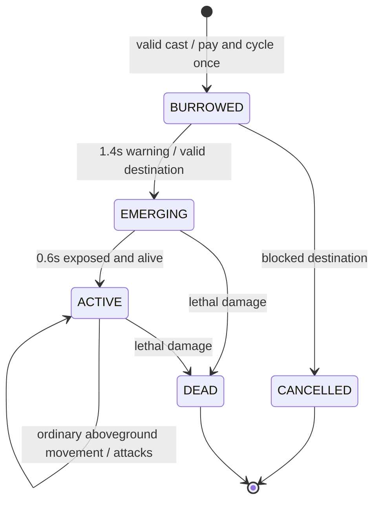

# King Frog and Nether Worm — runtime integration

Based directly on main `6e85dc77553bd17422deeb9cb51258cefda06fe5`.
Only these two cards are activated. The original 25 cards, their evolutions, default decks and balance values remain unchanged. The selectable pool becomes **27** (28 registry entries including dev-only Guardian). Netherite Crab, Ore Centipede and the five-mob asset PR are not imported or activated.

The selected designs follow [asset/concept review #21](https://github.com/Chazammm/CC-Minecraft-Royale/pull/21), revision `a0da310becfbdb028780ab698fa3d80a047e46a5`. This implementation contains its own runtime rasters and two LÖVE PNGs and does not require that PR to be merged.

## Delivered behavior

| Card | Cost | HP | Ordinary damage / interval | Speed | Melee / aggro range |
|---|---:|---:|---|---:|---|
| King Frog |3E|550|40 /1.4s|5|2.5 /27|
| Nether Worm |3E|350|95 /1.2s|9|2.5 /14|

Both are grounded, cannot attack flying/water-only targets, and have no new evolution. New melee timers preserve fractional attack progress across supported `dt` values without changing existing cards' timing contracts.

### King Frog: hook, then melee

- The tongue selects the current enemy ground-unit target outside melee and within **12** units. It has **0.25s** windup and a **4.2s** cooldown consumed on an attempted hook.
- Resolve against the same live target; cancel if it dies, becomes an invalid kind or leaves hook range. No hook against allies, air, water-only entities, buildings or either crown tower.
- All ground-unit sizes qualify, including Golem and Minoshroom. Current Villager / Emerald Bank are stationary **unit** entities and can be pulled too; their remaining lifetime and emerald source registration stay intact.
- Pull up to **9.5** units, stopping at **2.5** units from the Frog. Sample the straight path every≤0.5 units and stop at the last walkable point. No perpendicular sliding or river teleport. Reindex the victim immediately in the spatial grid.
- A victim can be pulled only once per combat tick, preventing same-tick multi-Frog chains. Resolution follows the existing deterministic, alternating combat traversal.
- The hook deals **zero damage** and does not reset either unit's ordinary attack clock. The Frog keeps its lock and can perform a normal40-damage melee hit on a later update once in range and ready. A partial terrain-blocked pull does not grant ranged damage.
- No aura, gameplay jump, permanent stun or pulling the Frog toward towers. Windup uses authoritative simulation time; tongue lines and the pose are cosmetic projections. Existing attack-rate modifiers also affect the hook cooldown through the shared modifier clock.

### Nether Worm: delayed arena-wide ambush

**Placement:** card-specific `placement="burrow"` reuses the finite-coordinate /3-unit border checks but permits walkable land on **either half**, including behind enemy Princess and King towers. Bridges are permitted; open river is not. Keep a **6-unit deployment clearance** from any live friendly/enemy tower or building. This is deployment safety, not a new collision hitbox. Villager/Bank do not become buildings because of their appearance. Other cards' own-half/pocket/bridge rules are unchanged.

**Transaction:** a valid cast spends3E and cycles once immediately. Invalid casts spend nothing. A pending record holds owner, position, card/unit data, committed cost and remaining delay; it is not an alive entity, not in the spatial grid, and cannot deal or receive damage.

- Draw the fixed **1.4s** warning as a ground raster with a small owner-color marker; it has no HP bar or hidden unit.
- During the final0.3s, revalidate once. If blocked, consider the original point and16 owner-relative offsets on radius2/4 rings. Choose only a valid nearby destination and show that corrected warning before spawn. There is no own-half fallback or arena-wide search.
- Recheck at spawn. If it becomes blocked again or no local correction exists, cancel and refund up to the committed3E, capped by available Emerald room. Do not rewind hand/cycle. Record actual credited `deploymentRefunds` and `cancelledDeployments` separately from gross spending; no duplicate refund or spawn.
- At warning expiry, create an ordinary350HP ground unit in both entity/spatial indexes. It is **targetable immediately** by troops, towers and spells for the entire **0.6s emergence**. It cannot move or attack then; damage flash and slow expiration still advance.
- Carry warning overshoot into the new actor's first emergence update. Unlocking emergence does not grant a same-tick attack; first action occurs on a later simulation update and never before2.0s from acceptance. Scheduling is quantized by the current simulation step (normally0.1s).
- On activation, a **2s** opener window permits **+85 once against a unit**, for180 total on that eligible hit. An actual building/tower neither receives nor consumes that bonus. Normal unit and building bites remain95.
- Apply **0.5× only to `target.kind=="tower"`**: Princess and King each take47.5 per ordinary bite. Cannon, Pillager Outpost and Portal take95. Villager and its Bank evolution are units, take full unit damage and are eligible for the opener.
- Acquire nearby economy units first, then other ground units, non-tower buildings and a nearby crown tower; otherwise use the existing lane objective. Preserve any valid acquired lock until normal invalidation. This avoids an ambush behind King marching past it toward a distant Princess when no better local target exists.
- After activation it always remains above ground; there is no second burrow, periodic immunity or segment-based hitbox.

Finish/result, lobby/reset/rematch, tiebreaker and dev clear discard pending deployments and unlanded hooks. Match-end cancellation does not modify a completed result with a refund. Dev direct-spawn deliberately bypasses cost and underground warning like existing admin spawns, but still starts the Worm's exposed emergence. Normal card play always uses the full warning.

## Integration points

- `src/cards.lua`: two definitions, validation for new mechanic payloads/transient-field protection and collection/Unit Info text.
- `src/arena.lua`: private burrow placement and bounded owner-relative correction.
- `src/custom_mob_rules.lua`: terrain-safe pull calculation, hook filters and Worm damage classification.
- `src/game.lua`: pending transactions, emergence, hook lifecycle, priorities, shared damage/kill handling, refunds and cleanup.
- `src/bot.lua`: in-hand/affordable Worm prediction at2s, economy/support candidates on both halves, tower-coverage penalty and shared legality checks. Frog defensive placement uses hook reach. Original default bot decks are unchanged.
- `src/diagnostics.lua`: pending deployment state/IDs and new timers participate in canonical snapshots/invariants, so headless comparisons cannot omit an underground transaction.
- `src/assets/custom_mobs/`: nine native rasters plus dispatch. `src/mob_assets.lua` delegates these two units while retaining all original four-mob frame/effect tables unchanged.
- `src/pixel_arena.lua`: real warning/owner cue beneath units, target-linked windup tongue and short release line. Existing final-canvas cache catches changes without per-unit image loads.
- `src/render.lua`: both special mechanics appear in Unit Info. Collection/deck/save systems use the existing card registry; no save format change.
- `install.lua`: all four additional installed Lua modules, including the shared mechanics suite. PNGs/host tools are not CC runtime inputs.
- `mechanics_test.lua`:41 new actual-engine cases registered alongside the existing audit suites.

## Native art and future LÖVE

[Registered poses](../../assets/sprites/frog_worm/previews/runtime_poses.png) · [Platform comparison](../../assets/sprites/frog_worm/previews/comparison.png) · [Real gameplay capture](../../assets/sprites/frog_worm/previews/gameplay_6x.png).

Frog: idle, crouched walk, extended tongue and separate melee mouth pose. Worm: idle, movement, bite, exposed emergence and a separate compact ground-warning raster. All use the existing palette and fit≤16×18; the warning is16×5 after removing the old unit-canvas padding. Both teams retain the existing HP bars, hurt flash and web overlay; death uses existing shared effects. These are compact native pose animations, not a full new animation engine.

The two transparent256×256 LÖVE masters are preserved unchanged from the reviewed package. Foot anchor(128,240), nearest filter,40 visible colors and binary alpha. Native drawing keeps the existing center anchor and texel snapping. Full LÖVE animation sheets / directional sets / a LÖVE application are not included.

## Review and remaining practical limits

[Validation and host performance evidence](VALIDATION.md). No physical Minecraft/CC monitor or running LÖVE/GPU instance was available. Captures prove the actual Lua renderer/PixelBox path, not real-hardware frame rates. The bot supports the new cards, but its heuristics are not a tournament-strength optimizer. The seeded matches validate mechanics/parity/replay, not final balance or win rates.

This is a separate implementation PR against main, not an automatic deployment or merge. The stock installer remains pinned to main; reviewing an unmerged version requires its checkout or a disposable installer copy with `BRANCH` set to the feature branch. Do not change production saves or installer defaults merely to preview the PR.
