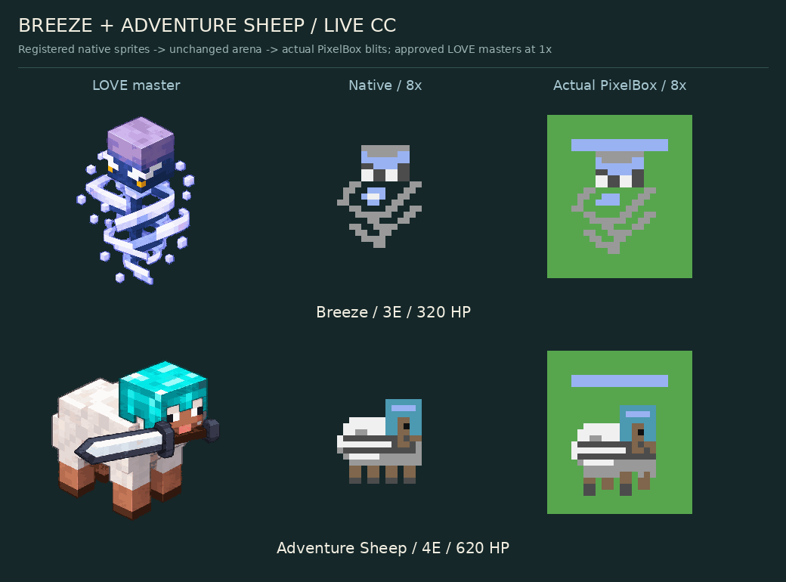

# Breeze und Adventure Sheep: CC:Tweaked-Integration

Basis: `main` / `e80ad6919b7eb21a1d3464290d177ee3ab210eee`. Implementiert auf eigenem Feature-Branch nach ausdrücklicher Freigabe für das CC:Tweaked-Spiel und Merge bei erfolgreichen Tests. **Phantom bleibt nicht registriert.** Der gemeinsame Konzept-PR #25 wird hierfür nicht gemergt.

| Karte | Kosten | HP | Schaden / Intervall | Bewegung | Reichweite / Aggro |
|---|---:|---:|---|---:|---|
| Breeze | 3E | 320 | 32 / 1,4 s | 6,6 | 15 / 30 |
| Adventure Sheep | 4E | 620 | 82 / 1,1 s | 7,4 | 2,5 / 27 |

Beide sind normale Bodentruppen mit normaler Platzierung, Zielbindung, Kartenzirkulation, Emerald-Abbuchung und Brückennavigation. Keine Evolution oder neue Platzierungsregel. Alle 28 vorherigen Card-Definitionen einschließlich der DEV-ONLY-Guardian-Definition, Evolutionen und Collection-Indizes bleiben unverändert; die zwei neuen Karten wurden an den bestehenden Pool angehängt. Der normale Pool wächst auf 29 Karten. Bots, Random Decks und Simulationen berücksichtigen die neuen registrierten Karten.

## Breeze

Die Figur schwebt optisch, ist aber keine fliegende Einheit. Sie kann weder Luft- noch Wasser-Units angreifen. Ein Schuss trifft genau ein Ziel. Gebäude und beide Kronentürme erhalten normale 32 Schaden und werden nie verschoben.

`windShotsFired` wird ausschließlich beim tatsächlichen Abschuss erhöht. Jedes dritte freigegebene Projektil trägt den Windstoß. Ein verfehltes oder durch Zieltod entferntes Projektil gibt die Ladung nicht zurück. Kein Bonus-Schaden, Splash, Stun oder Zurücksetzen des gegnerischen Angriffstimers beziehungsweise Target-Locks.

Beim Einschlag wird ein überlebender gegnerischer Bodentrupp um höchstens `min(4, aktuelle modifizierte Bewegungsgeschwindigkeit × 1 s)` vom Breeze weg verschoben. Die Richtung benutzt die aktuelle Position des lebenden Schützen beziehungsweise seine gespeicherte Abschussposition nach dessen Tod. Slows, Hero-Web und globale Bewegungsfaktoren werden beim Einschlag gelesen. Unbewegliche Units bleiben stehen.

`src/wind_rules.lua` prüft den vollständigen Weg in 0,25er-Schritten, maximal 16 Kandidaten. Am ersten ungültigen Terrainpunkt stoppen: kein Wasser-Sprung, kein seitlicher Ersatzpunkt, kein Wechsel der aktuell gewählten Brücke für ein gegenüberliegendes gelocktes Ziel. Der Spatial-Index wird nach einer echten Verschiebung aktualisiert. Eine erfolgreiche Verschiebung setzt **drei Sekunden gemeinsame Wind-Immunität am Opfer**, unabhängig davon, welcher Breeze anschließend trifft. Blockierte Verschiebungen verbrauchen keine Immunität. Weitere Treffer verursachen weiterhin normalen Schaden.

Die Immunität und Schussfolge sind Unit-Zustand; es entstehen keine unbeschränkt wachsenden globalen Listen. Live- und Headless-Spiel verwenden denselben Combat-/Projectile-Code. Effekte und Animationszustände sind ausschließlich visuell.

## Adventure Sheep

Normale einzelne Nahkampftreffer, kein Splash durch den sichtbaren Schwertbogen, kein Fernkampf, keine Heilung, kein zusätzlicher Helmblock und keine Anti-Air-Fähigkeit. Der normale Target-/Cooldown-Pfad erteilt genau einen Schadenstreffer. Bei Reichweite außerhalb 2,5 gibt eine große Schwertzeichnung kein zusätzliches Angriffsrecht.

Die tatsächlichen Engine-Duelle gegen Zombie und Wither Skeleton wurden für beide Besitzer bei `dt=0,05/0,1/0,25` geprüft. Das Schaf überlebt diese isolierten Duelle; das ist keine allgemeine Match-Winrate oder Balancegarantie. Die Kosten von 4E bleiben der freigegebene Startwert. Die bestehende Kartenbalance wurde nicht nachträglich an Testergebnisse angepasst.

## Native Grafik und Vorschauen

- [Breeze: Idle](../../assets/sprites/wind_sheep/previews/breeze_idle.gif), [Bewegung](../../assets/sprites/wind_sheep/previews/breeze_movement.gif), [Angriff](../../assets/sprites/wind_sheep/previews/breeze_attack.gif).
- [Sheep: Idle](../../assets/sprites/wind_sheep/previews/adventure_sheep_idle.gif), [Bewegung](../../assets/sprites/wind_sheep/previews/adventure_sheep_movement.gif), [Angriff](../../assets/sprites/wind_sheep/previews/adventure_sheep_attack.gif).
- [Gestellte Szene mit echten Combat-Effekten auf virtuellem Monitor](../../assets/sprites/wind_sheep/previews/gameplay_6x.png).

Die native Canvas bleibt **16 × 18 Pixel**, mit unveränderter CC-Palette und Punkt-Transparenz. Die freigegebenen Konzepte aus #25 wurden als kleine native Interpretation übernommen. Der Schaf-Schwertgriff sitzt am Maul, die Klinge verläuft seitwärts über den Wollkörper. Helle Klinge und dunkle Kontur sind in PixelBox-Zellbändern getrennt lesbar. Helm und vier Beine bleiben erkennbar. Die zwei separat ausgearbeiteten 256×256-LÖVE-Master werden unverändert als Referenz mitgeliefert; das laufende CC-Spiel lädt keine PNGs.

`src/assets/wind_sheep/dispatch.lua` wählt Idle-, Bewegungs-, Windup-, Angriffs- und Recovery-Posen anhand bestehender Visual-Timer. Breeze variiert zusätzlich seine Idle-Windspiralen. Hurt benutzt den bestehenden Damage-Flash. Beide Kreaturen haben kurze dreiphasige Todes-Effekte nach ihrer tatsächlichen Entfernung aus Combat/Targeting; keine tote Unit bleibt zur Animation kampffähig. Die Todes-Effekte laufen aus und werden entfernt.

Die sechs GIFs sind **Posenvorschauen aus echten Render-Captures**, keine Aufzeichnung der Attack-Cooldowns eines vollständigen Matches. Es gibt keine erfundene Hardwareaufnahme. PixelBox nähert jede 2×3-Zelle mit zwei Farben an; in dichten Überlagerungen können Details entfallen. Identität aller Bildpixel zwischen beliebigen vollständig überlappenden Kämpfen auf verschiedenen Lua-VMs wird nicht behauptet. Die geprüften Einzelposen und dokumentierte Szene sind zwischen Lua 5.2 und 5.4 gleich.

## Integration und Lieferung

- `src/cards.lua`: genau zwei neue auswählbare Karten, kurze Unit-Info-Texte und validiertes Wind-Schema.
- `src/game.lua`, `src/wind_rules.lua`: Schusszählung, sichere Verschiebung, begrenzte Visual-Effekte.
- `src/assets/wind_sheep/*`, `src/mob_assets.lua`: importierte native Sprites und Effekte; Renderer und PixelBox-Encoder bleiben unverändert.
- `src/bot.lua`: gezielte Platzierung und Bewertung der neuen Karten; bestehende Gewichte bleiben gleich.
- `install.lua`: alle sieben neuen Runtime-/Mechanikmodule werden tatsächlich ausgeliefert.
- `src/breeze_sheep_mechanics.lua`, `mechanics_test.lua`: 25 echte Engine-Fälle auch im installierten Mechaniktest.
- Drei neue entdeckte Lua-Testdateien, verschärfte Suite-Registrierungs-Negativkontrolle und eigener CI-Job für echte Sprite-/Capture-Parität.

Die bisherigen festen Kartenanzahl-Prüfungen wurden wegen der ausdrücklich autorisierten Pool-Erweiterung aktualisiert; keine Schadens-, Ergebnis- oder Performance-Assertion wurde zum Grünwerden abgesenkt. [Validierung und Grenzen](VALIDATION.md).
